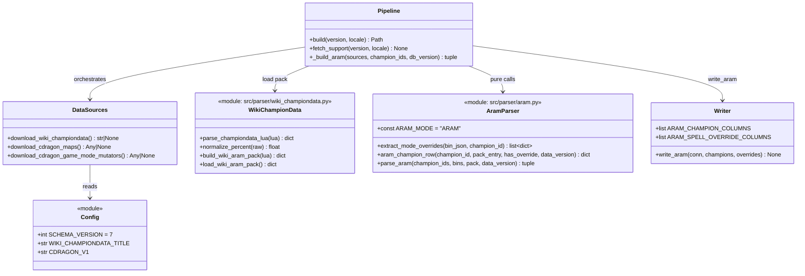
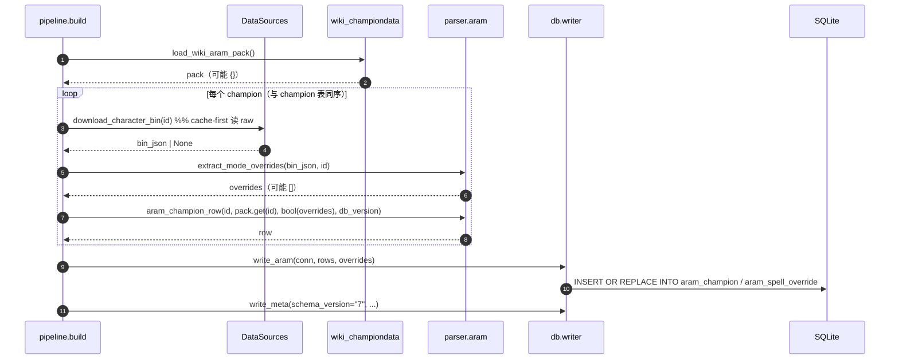

# 大乱斗（ARAM）专属数据 ETL 设计文档

> 目标仓库：`lol-assistant-data`（Python ETL → SQLite → Android Room）
> 本文档为**设计稿**，尚未实现。产出：`aram_champion` / `aram_spell_override` 两张新表，schema **v6 → v7**；只做 ETL 侧，不改 Android 仓库 `lolok`。
> 体例对齐 `docs/monster-etl-design.md`。
>
> **事实标注约定**：本文对每个关键结论标注证据等级——
> - ✅ **实测**：本次用 venv Python + requests / 本地 raw 缓存实跑复核，命令与结果内联。
> - 🟡 **旁证**：来自可复现的公开实现（社区项目源码），本环境未直接跑通（Wiki 当前 403）。
> - ⚠️ **待验证**：阻断于外部因素，实现前必须补测。

---

## 0. 结论摘要（TL;DR）

| 项 | 结论 |
| --- | --- |
| 「大乱斗专属数据」= | ① 英雄平衡调整（造成/承受伤害等 11 项）② 技能数值的大乱斗覆盖 ③ 专属名录（道具/召唤师技能/地图） |
| 主表 | `aram_champion`（每英雄 1 行，含 11 项平衡修正 + 是否有技能覆盖） |
| 附表 | `aram_spell_override`（每英雄每技能 1..N 行，`DataValuesModeOverride.ARAM` 展开） |
| 源 A（平衡调整） | LoL Wiki `Module:ChampionData/data`（🟡 旁证；同 `Module:SpellData/data` 一样走「fetch 缓存 → build 离线」） |
| 源 A'（平衡显示文案） | 客户端 stringtable `championbalancebuff_*`（✅ 实测，11 字段 × positive/negative，确认了字段全集） |
| 源 B（技能覆盖） | CommunityDragon 英雄 BIN `Characters/*/Spells/*/mSpell/DataValuesModeOverride.ARAM`（✅ 实测，**61 个英雄**命中） |
| 源 C（专属道具） | Data Dragon `item.json` → `maps."12" = true`（✅ 实测：**ARAM 独占 18 件**） |
| 源 D（专属召唤师技能） | Data Dragon `summoner.json` → `modes` 含 `ARAM`（✅ 实测：雪球 `SummonerSnowball`、清晰术 `SummonerMana` 为 ARAM 独占） |
| 源 E（地图） | CommunityDragon v1 `maps.json`（id 12 = Howling Abyss，`mapStringId="HA"`）+ `game-mode-mutators.json`（✅ 实测） |
| 数值语义 | 百分字段存**比值**（`1.0` = 不变、`0.9` = -10%）；平值字段（技能急速、韧性）存**原始平值**（见 §4） |
| 缺省 | 数值缺 → `1.0`（百分）/ `0.0`（平值）；无该行 = 未收录；**绝不编造** |
| fetch/build | fetch 联网暖 `raw/` + 生成 `cache/aram_balance_wiki.json`；build 只读缓存离线复跑，缺失降级 `[WARN]` 不中断 |
| 版本 | `config.SCHEMA_VERSION = 6 → 7` |
| 可选 v2 | 大乱斗增幅（Kiwi augments）/ 恩赐（boons）——见 §1.3、§12 |

---

## 1. 范围界定：什么算「大乱斗专属数据」

大乱斗（极地大乱斗 / ARAM / Howling Abyss，map id **12**）相较召唤师峡谷，有一层**模式专属**的数据。本次侦察把候选面**全量列出并实测可达性**，再给出推荐范围。

### 1.1 候选面 × 可达性矩阵（实测）

| # | 数据面 | 载体 | 机器可读 | 证据 | 建议 |
| --- | --- | --- | --- | --- | --- |
| 1 | **英雄平衡调整**（造成伤害/承受伤害/治疗/护盾/韧性/减速抗性/技能急速/移速/攻速成长/资源回复/对小兵群伤） | LoL Wiki `Module:ChampionData/data` | 是 | 🟡 | **v1 主打** |
| 2 | **技能数值的大乱斗覆盖** | 英雄 BIN `DataValuesModeOverride.ARAM` | 是 | ✅ | **v1 收录** |
| 3 | **专属道具** | Data Dragon `item.json` `maps."12"` | 是 | ✅ | **v1 收录（复用 item 表 + 派生）** |
| 4 | **专属召唤师技能** | Data Dragon `summoner.json` `modes` | 是 | ✅ | **v1 收录（复用 summoner_spell 表）** |
| 5 | **专属地图/地图皮肤** | CDragon v1 `maps.json` / `game-mode-mutators.json` | 是 | ✅ | **v1 收录（小表或 meta）** |
| 6 | 大乱斗增幅（Kiwi augments / 卡牌） | `augment-lists.json` + stringtable `kiwi_aram_*` | 部分 | ✅/⚠️ | v2（数值体未定位到，见 §12） |
| 7 | 大乱斗恩赐（`aram_boon_N`） | stringtable（仅名称占位） | 否 | ✅ | 排除（只有展示名，无数值源） |

### 1.2 推荐 v1 范围

只做 **1 + 2** 两张表 + **3/4/5 的「名录」说明**（不新增 schema，通过现有字段过滤即可）。理由：

- 1 和 2 是真正「大乱斗才有、且别处查不到」的数据；3/4/5 本质是既有表的一个**子集**（`item.maps` / `summoner_spell.modes` 已承载），为它们再建表属于冗余。
- 3/4/5 的过滤规则写进 `docs` 与 README 即可，App 侧一条 `WHERE` 就能取。

### 1.3 明确排除 / 降级到 v2

| 项 | 处置 | 理由 |
| --- | --- | --- |
| 大乱斗恩赐（`aram_boon_N`） | **排除** | stringtable 只有 `"大乱斗 恩赐 N"` 这类占位名，**无数值/描述载体**，编不出内容 |
| 大乱斗增幅（`kiwi_aram_*`） | **v2 可选** | 名称/描述在 stringtable（198 条）可读，但**效果数值的 SpellObject 未在 `map12.bin.json` 中定位到**（实测 0 命中），需先找到承载文件 |
| 英雄平衡调整的**逐 patch 历史** | **排除** | Wiki 有 history，但本项目是「当前版本快照」模型，不做版本回溯 |
| 竞技场（Arena/`cherry`）、URF、无限乱斗 | **排除** | 超出「大乱斗」边界；但 `DataValuesModeOverride` 解析器可复用（见 §11） |

---

## 2. 数据源与实测结论

### 2.1 源 A：英雄平衡调整（🟡 旁证 + ✅ 字段集实测）

**结论：平衡调整的「显示字段集」已实测确认；「每英雄数值」的权威机器源是 LoL Wiki `Module:ChampionData/data`（本环境当前 403，未直接跑通）。**

#### 2.1.1 字段集（✅ 实测：客户端 stringtable）

从已缓存的 `raw/16.20/zh_CN/cdragon/game/stringtable/zh_cn.lol.stringtable.json` 中命中 **24 个 `championbalancebuff_*` 键**（11 字段 × `positive`/`negative` + 1 条空态），这就是客户端「英雄平衡性增益」的全部条目：

| # | stringtable 键（前缀） | 中文（实测） | 占位符 | 语义 |
| --- | --- | --- | --- | --- |
| 1 | `championbalancebuff_outgoingdamage_*` | 造成伤害 | `@f1@%` | 百分 |
| 2 | `championbalancebuff_incomingdamage_*` | 承受伤害 | `@f2@%` | 百分 |
| 3 | `championbalancebuff_healingmodifier_*` | 治疗效果 | `@f3@%` | 百分 |
| 4 | `championbalancebuff_shieldingmodifier_*` | 护盾效果 | `@f4@%` | 百分 |
| 5 | `championbalancebuff_aoeminiondamagemultiplier_*` | 对小兵的群体伤害 | `@f5@%` | 百分 |
| 6 | `championbalancebuff_movementspeedmodifier_*` | 移动速度 | `@f6@%` | 百分 |
| 7 | `championbalancebuff_tenacitymodifier_*` | 韧性 | `@f7@` | **平值** |
| 8 | `championbalancebuff_slowresistmodifier_*` | 减速抗性 | `@f8@%` | 百分 |
| 9 | `championbalancebuff_attackspeedscalingmodifier_*` | 攻击速度增长 | `@f9@%` | 百分 |
| 10 | `championbalancebuff_abilityhastemodifier_*` | 技能急速 | `@f10@` | **平值** |
| 11 | `championbalancebuff_baseparpercentregenmodifier_*` | 施法资源回复 | `@f11@%` | 百分 |

> 注意键名与中文的**语义错位**（实测）：`_healingmodifier_` = **治疗效果**、`_shieldingmodifier_` = **护盾效果**、`_baseparpercentregenmodifier_` = **施法资源回复**。字段名不可望文生义。
>
> `championbalancebuff_nomodifiers = 已得到完美的平衡…` 是「该英雄无任何修正」的空态文案——**这解释了「为什么不是所有英雄都有行」**。

模板总入口：`game_mode_buff_desc_championbalancebuff = <titleLeft>英雄平衡性增益</titleLeft><mainText>@BuffModifierDescriptionAppend@</mainText><postScriptLeft>来自：@SourceName@</postScriptLeft>` —— 说明客户端把 11 段文案**按需拼接**（只拼非零项），并用 `positive`（绿 `#00a741`）/ `negative`（红 `#be1e37`）着色。

#### 2.1.2 「平衡调整数值不在客户端文件里」（✅ 实测，排除法）

为避免误判，本次在客户端数据里做了穷尽搜索：

| 搜索 | 范围 | 结果 |
| --- | --- | --- |
| 全英雄 BIN 顶层键含 `aram/mode/adjust/balance/modifier` | `raw/.../characters/*/*.bin.json` | **0** |
| `aatrox.bin.json` 全文大小写不敏感搜 `aram` | 同上 | **1**（仅 `RecSpellRankUpInfos/…/ModeNameStringId = ARAM`） |
| `CharacterRecords/Root` 是否含平衡字段（以 `ziggs` 为例 dump 全键） | 同上 | Root 只有 `baseHPModifiable` 等基础属性，**无模式修正** |
| `map12.bin.json` / `common.bin.json` 全文搜 `balance/adjust` | CDragon game | 仅 `Kiwi_Balance_Jade`（Arena），**无英雄平衡表** |
| 索引：`grep -rl 'Modifier\|Balance'` | 全英雄 BIN | 仅 10 个文件，全是技能内部修饰（`CriticalStrikeModifier` 等）与 2 处 `*ForModesBalance`（Kai'Sa/Taric 被动专用），**非模式平衡** |

> 结论：**每英雄的平衡数值是服务端下发/由模式脚本施加，客户端 only 有展示模板**。故必须外接权威源。

#### 2.1.3 权威机器源 = Wiki `Module:ChampionData/data`（🟡 旁证）

公开实现一致指向同一来源（🟡 旁证，非本环境跑通）：

- `nomi-san/balance-buff-viewer`（Pengu Loader 插件，覆盖 ARAM/URF/Arena/…）README 明确：**Balance data - `leagueoflegends.fandom.com/wiki/Module:ChampionData/data`**，`pnpm crawl` 后产出 `balance.json`。
- `dspos/league-insight` 的 ARAM 模块：从 Fandom API 拉取并用「大括号配平 + 字符串/注释忽略」的 Lua 解析器解析 **~160 英雄**，字段与建模：

  ```text
  AramBalanceData { championId, championName, allFields: Map<String, Double> }
  常见字段名: damage_dealt / damage_taken / healing / shielding /
             energy_regen|par_percent_regen / ability_haste / tenacity / ...
  示例: Yasuo(157) = { damage_dealt: 1.1, damage_taken: 1.0, healing: 0.9 }
  ```

  —— 即 **1.1 = +10%、0.9 = -10%** 的比值语义，与 §4 一致。

> 与字段集的映射（§2.1.1 ↔ 社区字段名）**待实测**（Wiki 403，见 §2.1.4）。本设计**不硬编码映射结果**，而是把 Wiki 原始块整体存入 `rawJson`，再做一次可复核的归一化（§4）。

#### 2.1.4 Wiki 可达性（⚠️ 待验证）

本环境实测：`wiki.leagueoflegends.com` 的 `api.php`（`prop=revisions`）/ `index.php?action=raw` / `rest.php/v1/page` **全部 403**（Cloudflare「Please wait」挑战页，~42 KB HTML）：

```text
wiki.leagueoflegends.com Module:SpellData/data att 0 403 42595
wiki.leagueoflegends.com Module:ChampionData/data att 0 403 42604
```

同一脚本的 fandom 镜像被沙箱代理 502 拦截。**但**：本项目 `raw/16.20/zh_CN/wiki/SpellData_data.lua` 已存在（58 KB，含 `ha`/`ar` map 标记），说明**早先可拉取**、且 `config.WIKI_API` 一直指向该域。

→ 设计沿用**既有 wiki 策略**：`fetch` 联网生成 `cache/aram_balance_wiki.json`，`build` 只读缓存。Wiki 挂掉时该 pack 缺失 → 平衡字段全缺省 + `[WARN]`，**不阻断 build**（与 `summoner_spells_wiki.json` 完全同构）。另提供**手工兜底** `cache/aram_balance.json`（见 §3.3）。

### 2.2 源 B：技能数值的大乱斗覆盖（✅ 实测）

**结论：英雄 BIN 里存在 `DataValuesModeOverride.ARAM`，按「技能 × 数值名」覆盖主数据值。当前 16.20 缓存中 61 个英雄命中。**

实测结构（`akali.bin.json`，逐条复核）：

```text
PATH /Characters/Akali/Spells/AkaliPAbility/AkaliP/mSpell
  modes: ['cherry', 'ARAM', 'Kiwi']
  ARAM: {"SpellDataValues": [{"name": "PassiveAPRatio",
          "values": [0.65, 0.65, ...], "__type": "SpellDataValue"}], ...}
PATH /Characters/Akali/Spells/AkaliQAbility/AkaliQ/mSpell
  modes: ['cherry', 'ARAM', 'Kiwi']
  ARAM: {"SpellDataValues": [{"name": "APRatio",
          "values": [0.70, 0.70, ...], ...}]}
PATH /Characters/Akali/Spells/AkaliRAbility/AkaliR/mSpell
  modes: ['ARAM', 'Kiwi', 'cherry']
  ARAM: {"SpellDataValues": [{"name": "R1APRatio", "values":[0.40,...]},
                             {"name": "R2APRatio", "values":[0.40,...]}]}
```

全英雄 BIN 的模式键统计（✅ 实测）：

```text
mode keys across champion bins: [('cherry', 372), ('Kiwi', 63), ('ARAM', 61),
  ('SWIFTPLAY', 25), ('URF', 24), ('{a110bc47}', 10), ('NEXUSBLITZ', 2),
  ('ULTBOOK', 1), ('ONEFORALL', 1)]
```

**关键坑（务必按此实现）：**

1. **覆盖是「按数值名」的差量，不是整段替换**。`DataValuesModeOverride.ARAM.SpellDataValues[i]` 只需用 `name` 去覆盖主 `mSpell.DataValues` 里同名项；未覆盖的数值**沿用主值**。→ 落地时**不宜**把覆盖值当完整技能数据另存一份，而是存「差量行」。
2. **模式名大小写敏感**：ARAM 用大写 `ARAM`；另有 `Kiwi`（大乱斗增幅系统，**同样属于大乱斗**）、`cherry`（竞技场）。v1 **只取 `ARAM`**；`Kiwi` 归 v2（其语义见 §12）。
3. **一个技能可有多条覆盖**（Akali R 覆盖了 `R1APRatio` + `R2APRatio`）。
4. **载入路径**：值在 `….mSpell.DataValuesModeOverride.<MODE>`；与该表的既有 BIN 定位逻辑（`src/parser/bin_scope.py`）一致，可直接复用 `scope_spell_objects`。
5. 数据**全离线可得**（英雄 BIN 已由 `fetch` 暖好），无需额外联网，也不需要 `cache/` 中间产物。

### 2.3 源 C：专属道具（✅ 实测）

Data Dragon `item.json` 的 `maps` 是 `{"11":bool,"12":bool,"22":bool,"30":bool,"453":bool}`。

| 过滤条件 | 命中 |
| --- | --- |
| `12=true 且 11=false` | 165（含与 Arena/JD 共用者） |
| `12=true 且 11/22/30/453 全 false` | **18**（真·ARAM 独占） |

ARAM 独占 18 件（实测，zh_CN 名）：

```text
1111 嘉文一世之靴   123430 毁坏仪式    124011 花晓之剑    126697 狂妄
226668 终极九头蛇   3039 阿塔玛的清算  4003 救生索      4004 幽魂弯刀
6032 属性加成       773513 海克斯核心原型 … 773516 完美海克斯核心
773517 蛋酒         773518 茶袋        773519 玉米糖      773521 生命药水
994403 金铲铲
```

> 其中 `773517/773518/773519`（蛋酒/茶袋/玉米糖）是**大乱斗的消耗品**，`773513…773516` 是**海克斯核心**成长线。均为既有 `item` 表的子集，**不新建表**。

### 2.4 源 D：专属召唤师技能（✅ 实测）

`summoner.json` 的 `modes` 是模式白名单。实测「几乎只属于 ARAM」的两个：

| id | 名 | modes（实测） |
| --- | --- | --- |
| `SummonerSnowball` | 标记（雪球） | `['KIWI','KIWI_JADE','ARAM','FIRSTBLOOD']` |
| `SummonerMana` | 清晰术 | `['KIWI','FIRSTBLOOD','ARAM','KIWI_JADE']` |

其余（闪现/治疗/屏障/净化/引燃/虚弱/疾步）虽也含 `ARAM`，但同时广泛用于经典/其它模式，**不属「专属」**。判据：`modes ⊆ {ARAM, KIWI, KIWI_JADE, FIRSTBLOOD}` → 记为 `aramExclusive`。（此项复用既有 `summoner_spell.modes` 列，不新增 schema。）

### 2.5 源 E：地图（✅ 实测）

- CDragon v1 `maps.json`（id 12）：

  ```json
  {"id":12,"name":"Random Map","mapStringId":"HA",
   "description":"The Howling Abyss is a bottomless crevasse ..."}
  ```
- CDragon v1 `game-mode-mutators.json`（实测）：`MapId=12` 有 4 个皮肤变体 `MapNameOverride`：`Koeshin's Crossing`（`MapSkin_Map12_Bloom`）、`Butcher's Bridge`（`MapSkin_HA_Bilgewater`）、`Bridge of Progress`（`MapSkin_HA_Crepe`）、`SR?`（`MapSkin_Map12_Jade`），`MapNameBase = Howling Abyss`。→ 与 patch 25.17 的「地图轮换」一致。

---

## 3. 收录规则与派生

### 3.1 `aram_champion`（英雄级）

```
输入：champion 全量（来自 Data Dragon champion.json，与 champion 表同键）
规则：
  1) 平衡块 = aram_pack[championId]（来自 cache/aram_balance_wiki.json）
  2) 若该英雄无任何非零修正 → 仍写一行（11 项全缺省），
     以区分「查过但确实无修正」与「源缺失」——用 hasBalance 列标记。
  3) 覆盖标记 hasSpellOverride = 是否存在任一 DataValuesModeOverride.ARAM
```

> **为什么全量保留？** 与 `champion` 表一一对应便于 App 侧 `JOIN`；缺省即「无修正」，语义明确。

### 3.2 `aram_spell_override`（技能级）

```
输入：英雄 BIN 的 Characters/<C>/Spells/**/mSpell/DataValuesModeOverride.ARAM
规则：
  1) 仅取 mode == "ARAM"（大小写精确）
  2) 仅取该技能 scoped 的 SpellObject（复用 bin_scope 定位，避免英雄级误配）
  3) 每个 <技能, 数值名> 一行；values 以 JSON 数组原样存（与主表 dataValues 对齐）
  4) 记录主值 hasBase = 主 mSpell.DataValues 中是否存在同名项
     （同名=覆盖，异名=新增；两者语义不同，见 §4.3）
```

### 3.3 平衡数值的兜底（手工缓存）

Wiki 不可得时，允许一份**手工维护**的 `cache/aram_balance.json`（与 `cache/champion_prices.json` 同性质、同降级语义）：

```json
{"source": "manual|wiki", "balance": {
  "Yasuo": {"damageDealt": 1.1, "damageTaken": 1.0, "healing": 0.9}}}
```

优先级：`cache/aram_balance.json`（若存在）**覆盖** wiki pack。理由：手工缓存是「人已核对」的最终兜底，与 `champion_prices.json` 的地位一致。

### 3.4 名录派生（不建表）

| 名录 | 取法（App 侧或 ETL 侧均可） |
| --- | --- |
| ARAM 专属道具 | `item.maps` JSON 中 `"12"=true` 且 `"11"/"22"/"30"/"453"` 均 false |
| ARAM 专属召唤师技能 | `summoner_spell.modes` ⊆ `{ARAM,KIWI,KIWI_JADE,FIRSTBLOOD}` |
| ARAM 地图 | `meta` 或独立 `aram_map` 小表（id=12 / HA / 4 皮肤变体） |

---

## 4. 数值语义与归一化（本设计的核心约定）

### 4.1 百分字段 vs 平值字段

| 类别 | 字段 | 存储 | 缺省 | 展示换算 |
| --- | --- | --- | --- | --- |
| 百分（比值） | 造成伤害、承受伤害、治疗、护盾、对小兵群伤、移速、减速抗性、攻速成长、资源回复 | `REAL`，**`1.0` = 100% 不变** | `1.0` | `(v - 1) * 100` 取整 → `+10%` / `-10%` |
| 平值 | 技能急速（`abilityHaste`）、韧性（`tenacity`） | `REAL`，**原始平值**（如 `-20` 或 `+10`） | `0.0` | 直接带符号 |

> 依据：`patchdelta.gg` 摘要「Sona **ARAM: Ability Haste** changed 12.22: Ability Haste changed to **-20** from 0」（平值）；`nomi-san/balance-buff-viewer` / `league-insight` 的 `damage_dealt: 1.1`（比值）。二者并存即 §4.1 的双语义。

### 4.2 归一化的（唯一）难点：Wiki 可能是比值，也可能是百分差

社区实现里同时出现过 `1.05` 与 `105`、`-10`。故实现时必须：

```python
def normalize_percent(raw) -> float:
    """Wiki 值 -> 比值。规则（先按量级判定，再截断，绝不猜测语义）：
       |raw| <= 2   → 已是比值 (1.1 → 1.1, 0.9 → 0.9)
       |raw| >  2   → 视作百分 (10 → 1.1, -10 → 0.9, 105 → 1.05)
    """
```

并把**原始值同时写入 `rawJson`**，使归一化结果可被逐条复核、可回滚。

### 4.3 覆盖 vs 新增

`aram_spell_override` 的一行可能是：

- **覆盖**（`hasBase=1`）：ARAM 改了某个已有数值（如 Akali Q `APRatio` 0.70）。→ 展示时**替换**主表 `dataValuesJson` 中同名项。
- **新增**（`hasBase=0`）：该数值只在大乱斗存在。→ 展示时**新增**。

`hasBase` 由此成为 App 端合并的**唯一开关**（避免 App 再自带 BIN 逻辑）。

---

## 5. Schema v7 完整 DDL

版本管理：`config.SCHEMA_VERSION = 6 → 7`；`pipeline.build()` 已用 `write_meta({... "schema_version": str(SCHEMA_VERSION) ...})`，**只改常量即自动生效**。

```sql
-- 大乱斗英雄专属数据：每英雄 1 行。风格与现有表一致：camelCase、全 NOT NULL、
-- 数值缺省 1.0/0.0、文本缺省 ''。数据源：LoL Wiki ChampionData（平衡）+ 英雄 BIN（覆盖标记）。
CREATE TABLE aram_champion (
    championId          TEXT    NOT NULL PRIMARY KEY,  -- 对齐 champion.id
    damageDealt         REAL    NOT NULL,   -- 造成伤害（比值，1.0=不变）
    damageTaken         REAL    NOT NULL,   -- 承受伤害（比值）
    healing             REAL    NOT NULL,   -- 治疗效果（比值）
    shielding           REAL    NOT NULL,   -- 护盾效果（比值）
    aoeMinionDamage     REAL    NOT NULL,   -- 对小兵的群体伤害（比值）
    moveSpeed           REAL    NOT NULL,   -- 移动速度（比值）
    tenacity            REAL    NOT NULL,   -- 韧性（平值）
    slowResist          REAL    NOT NULL,   -- 减速抗性（比值）
    attackSpeedScaling  REAL    NOT NULL,   -- 攻击速度增长（比值）
    abilityHaste        REAL    NOT NULL,   -- 技能急速（平值）
    resourceRegen       REAL    NOT NULL,   -- 施法资源回复（比值）
    hasBalance          INTEGER NOT NULL,   -- 0/1：源里查过且无任何非零修正=0；缺源也=0
    hasSpellOverride    INTEGER NOT NULL,   -- 0/1：是否存在 DataValuesModeOverride.ARAM
    rawJson             TEXT    NOT NULL,   -- Wiki 原始平衡块（复核/回滚用）
    dataVersion         TEXT    NOT NULL,   -- 数据版本（= db_version，如 '16.20'）
    FOREIGN KEY (championId) REFERENCES champion(id) ON DELETE CASCADE
);

CREATE INDEX idx_aram_champion_hasBalance ON aram_champion(hasBalance);

-- 大乱斗技能数值覆盖（差量）：每 <英雄, 技能, 数值名> 1 行。
CREATE TABLE aram_spell_override (
    championId   TEXT    NOT NULL,
    slot         TEXT    NOT NULL,   -- P/W/Q/E/R（与 champion_spell.slot 同域）
    spellName    TEXT    NOT NULL,   -- 技能脚本名，如 'AkaliQ'
    valueName    TEXT    NOT NULL,   -- 数值名，如 'APRatio' / 'R1APRatio'
    valuesJson   TEXT    NOT NULL,   -- 覆盖后的 values 数组（JSON）
    hasBase      INTEGER NOT NULL,   -- 1=覆盖已有同名数值；0=仅 ARAM 新增
    dataVersion  TEXT    NOT NULL,
    PRIMARY KEY (championId, slot, spellName, valueName),
    FOREIGN KEY (championId) REFERENCES champion(id) ON DELETE CASCADE
);

CREATE INDEX idx_aram_spell_override_champ ON aram_spell_override(championId);
```

**设计说明**

- 主键用 `championId`（对齐 `champion`），**不引入代理 id**；`aram_spell_override` 用四元组自然主键，天然幂等（`INSERT OR REPLACE`）。
- 百分字段缺省 `1.0`（不是 `0.0`）——**这是与全库其它 REAL 列最大的不同**，务必在 README 与 App 侧注明，否则 `0` 会被误读成「-100%」。
- **不建** `aram_augment` / `aram_boon`（见 §1.3）。
- `hasBalance` 用于区分「无修正」与「源缺失」：前者 `rawJson` 可能是 `{}`（Wiki 有该英雄但无修正），后者 `rawJson=''`（未命中源）。

---

## 6. 行 dict 字段清单

**`aram_champion`**

| dict 键 | 来源 | 类型 | 缺省 |
| --- | --- | --- | --- |
| `championId` | Data Dragon champion.json 的 id | str | —（必有） |
| `damageDealt` 等 9 个百分字段 | wiki 块 → `normalize_percent()` | float | `1.0` |
| `abilityHaste` / `tenacity` | wiki 块（平值） | float | `0.0` |
| `hasBalance` | wiki 块存在且至少一项非缺省 | int | `0` |
| `hasSpellOverride` | 该英雄 BIN 存在 `…/ARAM` | int | `0` |
| `rawJson` | 原始 wiki 块 `dumps()` | str | `''` |
| `dataVersion` | `db_version` | str | —（必有） |

**`aram_spell_override`**

| dict 键 | 来源 | 类型 | 缺省 |
| --- | --- | --- | --- |
| `championId` | 遍历英雄 | str | — |
| `slot` | 叶子技能名 → 槽位（复用 `bin_scope`/`spell` 规则） | str | `''` |
| `spellName` | BIN 对象路径叶子（如 `AkaliQ`） | str | — |
| `valueName` | `SpellDataValues[].name` | str | — |
| `valuesJson` | `SpellDataValues[].values` | str | `'[]'` |
| `hasBase` | 主 `mSpell.DataValues` 有同名项 | int | `0` |
| `dataVersion` | `db_version` | str | — |

---

## 7. fetch / build 职责划分

| 阶段 | 联网？ | 动作 | 落盘 |
| --- | --- | --- | --- |
| `fetch` | 是 | ① 拉 Wiki `Module:ChampionData/data`（base，写入 `raw/<v>/<loc>/wiki/ChampionData_data.lua`）② 解析出平衡块，写 `cache/aram_balance_wiki.json` ③ 顺带暖 `cdragon/v1/maps.json`、`game-mode-mutators.json` | `raw/`、`cache/` |
| `build` | 否（读缓存/raw） | ① 读 `cache/aram_balance_wiki.json`（缺则空）② 读英雄 BIN 抽 `DataValuesModeOverride.ARAM` ③ 写两张表 | `output/lol-<version>.db` |

**降级约定（沿用现有 `save_*` 家族，绝不停 build）**

- Wiki pack 缺失/空 → 11 个平衡字段全缺省、`hasBalance=0`、`rawJson=''`，打 `[WARN]`。
- 英雄 BIN 缺失 → 该英雄 `hasSpellOverride=0`，**不产生** `aram_spell_override` 行。
- `aram_spell_override` 天生「有则有、无则无」，无需额外 WARN。

**是否新增 `cache/aram_balance_wiki.json`？→ 新增。**

理由与 `summoner_spells_wiki.json` 一致：Wiki 抓取**贵且不稳**（当前 403），build 绝不能联网重试；把「联网渲染」锁在 `fetch`，`build` 只读缓存，才能保证离线复跑与确定性（§11）。**注意**：`DataValuesModeOverride.ARAM` **不落 cache**——它是廉价、确定性的 BIN 解析，直接读 `raw/`（与 monster 段同策略）。

**raw 缓存路径**

| 内容 | 相对路径 |
| --- | --- |
| Wiki 平衡模块 | `raw/<version>/<locale>/wiki/ChampionData_data.lua` |
| Wiki 原始响应 | `raw/<version>/<locale>/wiki/Module_ChampionData_data.query.json` |
| 英雄 BIN（已存在） | `raw/<version>/<locale>/cdragon/game/data/characters/<id>/<id>.bin.json` |
| 地图 | `raw/<version>/<locale>/cdragon/maps.json`、`…/game-mode-mutators.json` |

---

## 8. 模块与文件清单

| 文件（相对路径） | 动作 | 职责（一句话） |
| --- | --- | --- |
| `config.py` | 改 | `SCHEMA_VERSION=7`；新增 `WIKI_CHAMPIONDATA_TITLE="Module:ChampionData/data"`。 |
| `src/downloader/sources.py` | 改 | 新增 `download_wiki_championdata()`（复用 `_write_wiki_module`）；新增 `download_cdragon_maps()` / `download_cdragon_game_mode_mutators()`。 |
| `src/parser/wiki_championdata.py` | **新增** | 纯函数：解析 Lua 平衡块 → `{championKey: {field: value}}`；`normalize_percent()`；`build_wiki_aram_pack()` / `load_wiki_aram_pack()`（对齐 `wiki_summoner.py`）。 |
| `src/parser/aram.py` | **新增** | 纯函数：`extract_mode_overrides(bin_json, mode="ARAM")` → 差量行；`aram_champion_row()`；`parse_aram(...)`。 |
| `src/db/schema.py` | 改 | 追加两张表与索引（§5）。 |
| `src/db/writer.py` | 改 | 新增 `ARAM_CHAMPION_COLUMNS` / `ARAM_SPELL_OVERRIDE_COLUMNS` 与 `write_aram()`。 |
| `src/pipeline.py` | 改 | `build()` 集成 aram 段（先写 champion，再写 aram，保证外键）；`fetch_support()` 暖 wiki + maps；`stats()` 表清单加两表。 |
| `src/main.py` | 改（可选） | `inspect` 增 `--aram <champion>`。 |
| `tests/test_wiki_championdata.py` | **新增** | Lua 解析 / 归一化 / 兜底 / 确定性（§13）。 |
| `tests/test_aram.py` | **新增** | `DataValuesModeOverride.ARAM` 抽取 / scoping / `hasBase` / 缺省（§13）。 |
| `README.md` | 改 | schema v6→v7；`What gets built` 加两行；补 ARAM 数据源、§4 数值语义、§3.4 名录过滤。 |

---

## 9. 数据结构与接口

### 9.1 类图（classDiagram）



### 9.2 关键函数签名

```python
# src/parser/wiki_championdata.py
def parse_championdata_lua(lua: str) -> dict[str, dict[str, float]]:
    """解析 Module:ChampionData/data 的 Lua，返回 {championKey: {field: raw}}。
    只提取含 ARAM 平衡的条目；其余忽略。任何解析异常 → 跳过该英雄（不抛）。"""

def normalize_percent(raw: float) -> float:
    """Wiki 值 -> 比值。|raw|<=2 视为比值；否则视为百分差（§4.2）。"""

def build_wiki_aram_pack(lua_en: str) -> dict[str, dict[str, float]]:
    """英文模块 -> {championKey: {11 个规范字段: 归一后值}}。"""

def load_wiki_aram_pack() -> dict[str, dict[str, float]]:
    """读 cache/aram_balance_wiki.json（含手工 cache/aram_balance.json 覆盖）；
    缺失/损坏 → {}（降级）。"""

# src/parser/aram.py
def extract_mode_overrides(bin_json, champion_id: str) -> list[dict]:
    """遍历 scoped SpellObject，取 mSpell.DataValuesModeOverride['ARAM']，
    展开为 [{slot, spellName, valueName, valuesJson, hasBase}]；无则 []。"""

def aram_champion_row(champion_id, pack_entry, has_override, data_version) -> dict:
    """组装 aram_champion 行；pack_entry 为空 → 全缺省 + hasBalance=0。"""
```

### 9.3 `AramParser` 常量

```python
ARAM_MODE = "ARAM"                 # BIN 里的模式键（大小写精确）
PERCENT_FIELDS = {                  # 归一为比值，缺省 1.0
    "damageDealt", "damageTaken", "healing", "shielding",
    "aoeMinionDamage", "moveSpeed", "slowResist",
    "attackSpeedScaling", "resourceRegen",
}
FLAT_FIELDS = {"abilityHaste", "tenacity"}   # 平值，缺省 0.0
```

---

## 10. 程序调用流程

### 10.1 fetch（联网暖 raw + 生成 wiki pack）

```mermaid
sequenceDiagram
    autonumber
    participant CLI as main.fetch
    participant FS as fetch_support
    participant DS as DataSources
    participant W as Wiki
    participant CD as CommunityDragon

    CLI->>FS: fetch_support(version, locale)
    FS->>DS: download_wiki_championdata()
    DS->>W: GET api.php?prop=revisions&titles=Module:ChampionData/data
    alt 200
        W-->>DS: Lua 源码
        DS->>FS: 返回 lua
        FS->>FS: build_wiki_aram_pack(lua) -> cache/aram_balance_wiki.json
    else 403 / 超时
        W-->>DS: HTML 挑战页
        DS->>FS: [WARN] 降级返回 None
        FS->>FS: pack = {} （平衡字段全缺省）
    end
    FS->>DS: download_cdragon_maps(); download_cdragon_game_mode_mutators()
    DS->>CD: GET v1/maps.json, v1/game-mode-mutators.json
    FS-->>CLI: [OK] aram raw warmed
```

### 10.2 build（离线复跑）



---

## 11. 共享知识 / 跨文件约定

- **数值双语义（最重要）**：百分字段 `1.0`=不变（**不是 `0`**）；平值字段 `0`=不变。App 侧若按「0=不变」渲染会全错。
- **覆盖是差量**：`aram_spell_override` 只存「与主数据不同的项」，由 `hasBase` 决定合并方式（替换/新增）。**不要**另存完整技能数据。
- **模式键大小写敏感**：`ARAM`（大写）。v1 忽略 `Kiwi`/`cherry`。
- **缺失即降级，绝不编造**：Wiki 缺 → 缺省；BIN 缺 → 该英雄无覆盖；单条解析失败 → 跳过该英雄 + `[WARN]`，build 仍成功。
- **确定性**：`championId` 排序遍历；Lua 解析对同一输入结果稳定。`meta.generated_at` / `latest.json.generatedAt` 仍是墙钟（既有约束），故**确定性要求只约束 aram 表内容**。
- **locale 无关**：平衡字段是**语言中立**的数值；中文展示文案由客户端拼 `championbalancebuff_*`（§2.1.1），ETL 不落文案。文件名 `raw/.../wiki/ChampionData_data.lua` 沿用英文模块（对齐 `SpellData_data.lua`）。
- **边界**：`aram_spell_override.slot` 与 `champion_spell.slot` 同域（P/W/Q/E/R），App 可直接 `JOIN champion_spell USING(championId, slot)`。

---

## 12. 待明确事项（需用户拍板）

| # | 事项 | 建议默认 | 影响 |
| --- | --- | --- | --- |
| 1 | **v1 范围**：是否只做 `aram_champion` + `aram_spell_override`？ | 是（§1.2） | 决定工期与表数量 |
| 2 | Wiki 403 常态下如何取平衡数值？ | 允许 `cache/aram_balance.json` 手工兜底（§3.3） | 无兜底则平衡表长期空 |
| 3 | 是否要 `aram_map` 独立小表（含 4 个皮肤变体）？ | **否**，写入 `meta` 即可 | +1 表 |
| 4 | ARAM 专属道具/召唤师技能是否要**额外布尔列**（如 `item.aramOnly`）？ | 否，用过滤规则（§3.4） | 改既有表 = 破坏「只加不改」 |
| 5 | `Kiwi` 模式（大乱斗增幅）是否纳入？ | **v2**（需先定位增幅数值载体） | +1~2 表 |
| 6 | 平值字段（技能急速/韧性）Wiki 是否也是比值？ | 按 §4.1 双语义实现，**待 Wiki 恢复后实测** | 归一化正确性 |
| 7 | 是否输出「逐 patch 历史」？ | **否**（快照模型） | — |

---

## 13. 测试用例清单

**`tests/test_wiki_championdata.py`**

| 用例 | 断言 |
| --- | --- |
| Lua 解析：单英雄单字段 | `Yasuo {damage_dealt=1.1}` → `{damageDealt: 1.1}` |
| `normalize_percent` 比值 | `1.1 → 1.1`、`0.9 → 0.9` |
| `normalize_percent` 百分 | `10 → 1.1`、`-10 → 0.9`、`105 → 1.05` |
| 空/损坏 Lua | 返回 `{}`，不抛异常 |
| pack 缺失 | `load_wiki_aram_pack() == {}`（降级） |
| 手工缓存优先 | 同时存在 `aram_balance.json` 与 wiki pack → 手工值胜出 |
| 确定性 | 同输入两次 → 完全一致 |

**`tests/test_aram.py`**

| 用例 | 断言 |
| --- | --- |
| 抽 `DataValuesModeOverride.ARAM` | 给定 Akali 样本 → 3 条覆盖（P/Q/R×2 中的 Q、R 两条等） |
| 大小写敏感 | 只有 `aram`（小写）键 → 不命中 |
| `hasBase` 判定 | 主 DataValues 有同名 → 1；否则 0 |
| 无覆盖 | 无 `DataValuesModeOverride` → `[]`，`hasSpellOverride=0` |
| 缺省语义 | 无平衡块 → 9 个百分字段 = `1.0`、2 个平值 = `0.0`、`hasBalance=0` |
| scoping | 兄弟技能的同名数值不串（复用 `bin_scope` 语义） |
| 确定性 | 同输入两次 → 行列表逐字节相同 |

---

## 附 A：平衡字段速查（stringtable 实测键名 ↔ 建议列名 ↔ 语义）

| stringtable 键前缀 | 建议列名 | 类别 | 中文 |
| --- | --- | --- | --- |
| `…_outgoingdamage_` | `damageDealt` | 比值 | 造成伤害 |
| `…_incomingdamage_` | `damageTaken` | 比值 | 承受伤害 |
| `…_healingmodifier_` | `healing` | 比值 | 治疗效果 |
| `…_shieldingmodifier_` | `shielding` | 比值 | 护盾效果 |
| `…_aoeminiondamagemultiplier_` | `aoeMinionDamage` | 比值 | 对小兵的群体伤害 |
| `…_movementspeedmodifier_` | `moveSpeed` | 比值 | 移动速度 |
| `…_tenacitymodifier_` | `tenacity` | 平值 | 韧性 |
| `…_slowresistmodifier_` | `slowResist` | 比值 | 减速抗性 |
| `…_attackspeedscalingmodifier_` | `attackSpeedScaling` | 比值 | 攻击速度增长 |
| `…_abilityhastemodifier_` | `abilityHaste` | 平值 | 技能急速 |
| `…_baseparpercentregenmodifier_` | `resourceRegen` | 比值 | 施法资源回复 |

## 附 B：实测命令（可复核）

```bash
# 1) 平衡显示字段集（✅）
python - <<'PY'
import json; d=json.load(open('raw/16.20/zh_CN/cdragon/game/stringtable/zh_cn.lol.stringtable.json',encoding='utf-8'))['entries']
print([k for k in d if 'championbalancebuff' in k])
PY

# 2) BIN 模式覆盖（✅）
python - <<'PY'
import json,glob,collections
c=collections.Counter()
for p in glob.glob('raw/16.20/zh_CN/cdragon/game/data/characters/*/*.bin.json'):
    d=json.load(open(p,encoding='utf-8'))
    def f(o):
        if isinstance(o,dict):
            for k,v in o.items():
                if k=='DataValuesModeOverride' and isinstance(v,dict): c.update(v.keys())
                f(v)
        elif isinstance(o,list): [f(v) for v in o]
    f(d)
print(c.most_common())
PY

# 3) ARAM 独占道具（✅）
python - <<'PY'
import json; it=json.load(open('raw/16.20/zh_CN/ddragon/item.json',encoding='utf-8'))['data']
print([v['name'] for v in it.values()
       if v.get('maps',{}).get('12') and not any(v['maps'].get(m) for m in ('11','22','30','453'))])
PY
```
