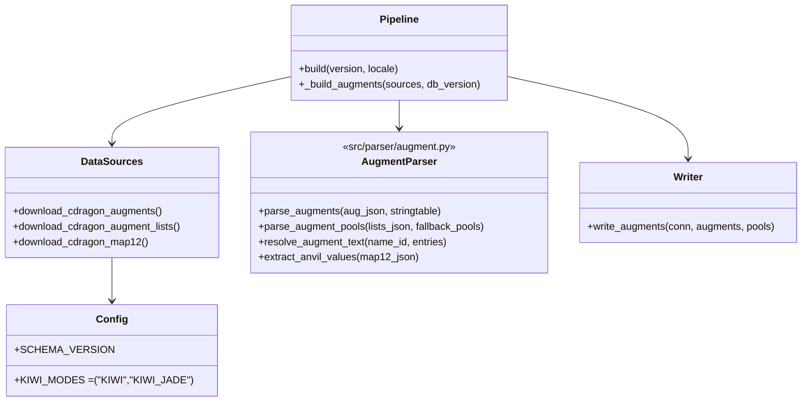
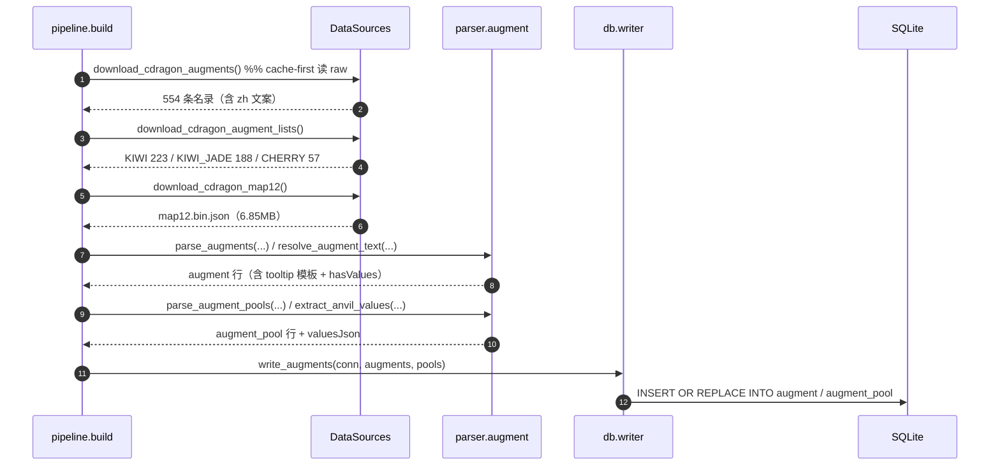

# 海克斯大乱斗（Hextech ARAM / `KIWI`）数据面 ETL 设计

> 目标仓库：`lol-assistant-data`（Python ETL → SQLite → Android Room）
> 本文档为**设计稿**，尚未实现。产出：`augment` / `augment_pool` 两张新表。
> 体例对齐 `docs/aram-etl-design.md`、`docs/monster-etl-design.md`；版本变更历史见
> `docs/patch-history-etl-design.md`（两稿共用同一条 patch 轴）。
>
> **事实标注约定**：✅ **实测**（本次用 venv Python + requests 实跑，命令/结果内联）；
> 🟡 **旁证**（社区实现/公开信息，本环境未直接跑通）；⚠️ **待验证**。

---

## 0. 结论摘要（TL;DR）

| 项 | 结论 |
| --- | --- |
| 模式身份 | **`KIWI` = 海克斯大乱斗**（✅ 实测 `queue_name_kiwi = '海克斯大乱斗'`）；`KIWI_JADE` = 海克斯大乱斗 经典模式版 |
| ⚠️ 命名陷阱 | 队列 2300 `Brawl` 的中文是 **「神木之门」**（`queue_name_brawl_5v5`），**不是**海克斯大乱斗；一切 `brawl_*` 数据与此模式无关 |
| 旧稿需更正 | `docs/aram-etl-design.md` §1.3 把 `Kiwi` 记为「大乱斗增幅系统」并降到 v2 —— 实测 Kiwi 是**独立模式**（海克斯大乱斗），不是极地大乱斗的附属系统 |
| 强化符文名录 | ✅ 100% 可得：`v1/cherry-augments.json`（zh_cn 可本地化），554 条，其中 `ARAM_*` **170 条** = 海克斯大乱斗符文 |
| 符文池 | ✅ `v1/augment-lists.json`：`CHERRY` 57 / **`KIWI` 223** / **`KIWI_JADE` 188** |
| 稀有度 | ✅ `kSilver` 166 / `kGold` 196 / `kPrismatic` 167 / `kEventChoice` 25（全量） |
| 中文名 | ✅ 92%（157/170）来自 stringtable `kiwi_*_name` 键族，可与 `nameTRA` 交叉校验（实测一致） |
| 描述文案 | ✅ 51%（86/170）拿到带 `@token@` 的 `_tooltip` 模板；38% 拿到 `_summary` 散文版 |
| 符文数值 | 🟡 **不完整**：`map12.bin.json` 里 37 个「属性锻造器」类符文有确定性数值（`RootSpell → mSpell.DataValues`）；其余多数符文的数值落点未定位 → v1 留空 + `hasValues` 标记，绝不编造 |
| 符文增删 | ✅ 可由两版本 `cherry-augments.json` + `augment-lists.json` 直接 diff 得出，并与官方公告交叉验证 |
| 模式平衡数值 | 🟡 客户端只有展示模板（`championbalancebuff_*`，见 aram 稿 §2.1.1）；数值由服务端下发 → 走官方版本公告（见 §7） |
| fetch/build | fetch 联网暖 `raw/`（3 个 v1 接口 + stringtable）；build 只读缓存离线复跑，缺源降级 `[WARN]` 不中断 |
| Schema | `SCHEMA_VERSION = 6 → 7`（与 aram 稿的 v7 二选一，见 §9 版本号协调） |

---

## 1. 模式身份：先钉死 `KIWI`

命名是这个数据面最大的坑。三条实测证据：

```text
queue_name_kiwi            = '海克斯大乱斗 '        # ✅
queue_name_kiwi_jade       = '海克斯大乱斗 经典模式版'  # ✅
queue_name_brawl_5v5       = '神木之门'              # ✅ ← 完全不同的模式
```

配套证据：

| 证据 | 实测值 | 说明 |
| --- | --- | --- |
| `augment-lists.json` 模式池 | `CHERRY` / `KIWI` / `KIWI_JADE` | 符文池按**模式代号**分组，无 `Brawl` 池 |
| 召唤师技能 `modes` | `SummonerSnowball` = `['KIWI','KIWI_JADE','ARAM','FIRSTBLOOD']` | 雪球/清晰术在 KIWI 与 ARAM 同域可用 |
| 队列 | `2400/2401/2403/2405/2410/2450/3240/3270/3280` = `ARAM: Mayhem`（`kARAM`） | KIWI 家族的队列组，2026 命名 |
| 地图 | `map id 12` = Howling Abyss（4 个皮肤变体） | 与 aram 稿 §2.5 同源 |
| stringtable | 含「海克斯大乱斗」的键 **32** 条；`kiwi_*` 键 **736** 条 | 模式文案体量 |

> **落地要求**：表名、解析常量一律用 `KIWI` / `KIWI_JADE`；`displayName` 才写「海克斯大乱斗」。
> `Brawl`（神木之门）在本设计范围内**显式排除**，避免后续误接。

---

## 2. 源 A：强化符文名录（✅ 实测）

`plugins/rcp-be-lol-game-data/global/{loc}/v1/cherry-augments.json`（`loc` = `default` / `zh_cn`）

```json
{"id": 1205, "augmentNameId": "ARAM_ADAPt", "nameTRA": "物理转魔法",
 "simpleNameTRA": "", "augmentSmallIconPath":
 "/lol-game-data/assets/ASSETS/UX/Cherry/Augments/Icons/ADAPt_small.png",
 "rarity": "kSilver"}
```

实测统计（zh_cn 与 default 条目数一致，仅文案本地化）：

| 指标 | 值 |
| --- | --- |
| 全量条目 | **554** |
| `augmentNameId` 以 `ARAM_` 开头 | **170** ← 海克斯大乱斗符文 |
| rarity 分布（全量） | `kSilver` 166 / `kGold` 196 / `kPrismatic` 167 / `kEventChoice` 25 |
| rarity 分布（仅 `ARAM_*`） | `kGold` 60 / `kPrismatic` 59 / `kSilver` 51 |

**注意**：接口名是 `cherry-`（Arena 代号），但**它同时承载 ARAM/KIWI 符文**——`ARAM_` 前缀就是区分依据，不要因为文件名而放弃这个源。

---

## 3. 源 B：符文池（✅ 实测）

`v1/augment-lists.json` 是**列表**，每个元素 `{augmentList: [...], modeName: "..."}`：

| `modeName` | 池大小 | 元素示例 |
| --- | --- | --- |
| `CHERRY` | 57 | `Maps/ModeSpecificData/Augments/ARAM_GetExcited` |
| **`KIWI`** | **223** | `Maps/ModeSpecificData/Augments/ARAM_BigBrain` |
| **`KIWI_JADE`** | **188** | 同上（子集 + 差异项） |

补充：`map12.bin.json` 内另有 3 个 `AugmentFallbackPool`（`rarity` + 池 + `__type`），是**兜底池**，v1 收录但标记 `poolKind='fallback'`，不参与主池统计。

**池 ⊋ 170**：池里混有非 `ARAM_` 前缀的条目（`ForgedByTheMaster`、`BrushPower`、`Donation`…）。故 `augment` 表收**全量 554 条**，`augment_pool` 表只负责标出「哪些在 KIWI 池里」，App 侧一条 `JOIN` 即得模式可用符文。这样后续池子扩张不需要改 schema。

---

## 4. 源 C：中文名与描述模板（✅ 实测，含映射规则）

客户端 stringtable（`raw/<v>/<locale>/cdragon/game/stringtable/<locdir>.lol.stringtable.json`，`fetch` 已暖）：

| 键族 | 条数 | 带 `@token@` |
| --- | --- | --- |
| `kiwi_*_name` | 273 | 0（纯名） |
| `kiwi_*_tooltip` | 203 | **184** |
| `kiwi_*_summary` | 155 | 0（散文版） |
| `kiwi_*_description` / `_tiertooltip` | 20 / 5 | — |

**映射规则不是单一前缀**（这是本设计最容易踩的坑，实测两组反例）：

```text
ARAM_ADAPt     -> kiwi_aram_adapt_name      "物理转魔法"       # name 用 aram_ 中缀
ARAM_BigBrain  -> kiwi_bigbrain_tooltip     "获得@TotalShield@护盾值。…"  # tooltip 用裸名
ARAM_BladeWaltz-> kiwi_bladewaltz_tooltip   "…造成@Damage@伤害@TotalHits@次…"
```

→ 实现为**候选键有序表**，第一个命中即用，并记录命中键（可复核、可回归）：

```python
AUGMENT_KEY_CANDIDATES = (
    ("kiwi_aram_{bare}", "kiwi_{bare}", "kiwi_{full}"),   # full = nameId 全小写
)
# 取 name   : 依次试 "<base>_name"
# 取 tooltip: 依次试 "<base>_tooltip" -> "<base>_summary"
```

实测覆盖率（170 条 `ARAM_*`）：

| 字段 | 命中 | 覆盖率 |
| --- | --- | --- |
| `name`（`_name`） | 157 | 92% |
| `tooltip`（`_tooltip`） | 86 | 51% |
| `summary`（`_summary`） | 64 | 38% |
| `name` 与 `nameTRA` 一致性 | 实测样本 5/5 相同（`物理转魔法`/`全心为你`/`尖端发明家`/`回归基本功`/`超强大脑`） | 交叉校验通过 |

示例（zh_cn 实测，`@token@` 与客户端标记原样保留）：

```text
kiwi_bigbrain_tooltip    = 获得<shield>@TotalShield@护盾值</shield>。阵亡时或耗尽后70秒重置。
kiwi_bladewaltz_tooltip  = 让你进入不可被选取状态，在此期间对敌人进行突进并造成@Damage@伤害@TotalHits@次(造成50%附带伤害)。
kiwi_circleofdeath_tooltip = 你的<health>治疗效果</health>和<health>生命回复效果</health>会对相距最近的那个敌方英雄造成<magicDamage>@HealToDamageConversion*100@%该数额的魔法伤害…</magicDamage>
```

**渲染交给客户端**（与 `champion_spell.tooltipRendered` 同一约定）：ETL 只存模板，App 侧用已有的 `{{ }}`/`@token@` 解释器填数。

---

## 5. 源 D：符文数值（🟡 部分可得 —— 与旧稿结论的差异）

`game/data/maps/shipping/map12/map12.bin.json`（**6.85 MB / 1058 个顶层键**）是海克斯大乱斗的关卡数据。

**已证实的确定性数值路径**（✅ 实测）：

```text
/{3afc663c}  {"AugmentNameId": "ARAM_StatAnvil_Hybrid1",
              "AugmentTooltipTra": "Cherry_GoldStatAnvil_Hybrid1_Tooltip",
              "RootSpell": "{040012e1}", "__type": "AnvilData"}
   └─ {040012e1} → mSpell.DataValues = [MinAS=0.10, MinAH=8.0]

/{713613eb}  ARAM_GoldStatAnvil_MPen  → RootSpell {06073edf} → DataValues = [MinMPen=18.0]
/{0b5c8c69}  ARAM_PrisStatAnvil_HP    → RootSpell {696c434b} → DataValues = [MinHP=0.15, SizeGain=0.10]
/{341b8de7}  ARAM_StatAnvil_CritChance→ RootSpell {163c350f} → DataValues = [MinCritChance=0.08]
```

即 **37 个 `AnvilData`（属性锻造器系列）** 的数值是**本地可解析**的；另有 `Maps/Shipping/Map12/Spells/Kiwi_*` 一族带 `mSpell.DataValues`（`Kiwi_ComboBreaker` = `TenacityAmp 0.20`、`Kiwi_OnFireBuff` = `GrievousAmount -0.25`…）。

**但覆盖率不完整**（✅ 实测：170 个符文名在 `map12.bin.json` 全文出现的次数分布）：

| 命中次数 | 符文数 | 含义 |
| --- | --- | --- |
| `0` | **111** | 与该文件无关（如 `ARAM_ADAPt`、`ARAM_Archmage`） |
| `1` | 14 | 只出现在池列表里（如 `ARAM_ApexInventor`），无数值承载 |
| `≥2` | 45 | 有实现对象/资产（`ARAM_BladeWaltz` 6、`ARAM_Firefox` 18、`ARAM_KingMe` 13…） |

tooltip 里的 token 名同样大部分**不在** `map12`：`ResistsPerLevel` 0、`AugDuration` 0、`DamageAmp` 0、`APPerProc` 0 命中（`MaxStacks` 6、`AbilityHaste` 4）。→ 其余符文的数值分散在其它 BIN（装备/BUFF/英雄技能实现），**承载文件尚未定位**。

> **对旧稿的修正**：`docs/aram-etl-design.md` §1.3 写「`kiwi_aram_*` 效果数值的 SpellObject 在 `map12.bin.json` 中定位到（实测 0 命中）」——本次复核结论是**部分符文有、多数没有**。定位方法的差异在于：需按**符文名的裸名**（而非 `kiwi_aram_` 前缀）在该文件里检索，并按 `AnvilData.RootSpell` 跳一次哈希引用才能拿到 `DataValues`。

**处置（v1 边界）**：

| 项 | v1 | v2 |
| --- | --- | --- |
| 名录 / 池 / 稀有度 / 图标 / 中文名 / 描述模板 | **收录** | — |
| 37 个锻造器 + `Kiwi_*` 一族数值 | 收录到 `valuesJson`，`hasValues=1` | — |
| 其余 ~133 个符文数值 | 留空（`valuesJson='{}'`、`hasValues=0`） | 逐符文解析 `RootSpell` / 跨文件引用，只填能确定性取到的 |

---

## 6. Schema v7 DDL

```sql
-- 强化符文名录（全量 554 条，含非 ARAM 前缀）。数据源：CDragon v1 cherry-augments
-- + stringtable（文案）；数值来自 map12 BIN（能取则取）。
CREATE TABLE augment (
    id           INTEGER PRIMARY KEY NOT NULL,  -- cherry-augments.id
    nameId       TEXT    NOT NULL UNIQUE,       -- augmentNameId，如 'ARAM_BigBrain'
    name         TEXT    NOT NULL,              -- nameTRA（zh_CN 本地化）
    nameSimple   TEXT    NOT NULL,              -- simpleNameTRA，缺省 ''
    rarity       TEXT    NOT NULL,              -- kSilver/kGold/kPrismatic/kEventChoice
    iconSmall    TEXT    NOT NULL,              -- augmentSmallIconPath（缺省 ''）
    iconLarge    TEXT    NOT NULL DEFAULT '',
    nameSource   TEXT    NOT NULL,              -- stringtable 命中键 / 'nameTRA'（可复核）
    tooltip      TEXT    NOT NULL,              -- @token@ 模板（含客户端标记）
    tooltipSummary TEXT  NOT NULL,              -- 散文版，缺省 ''
    hasValues    INTEGER NOT NULL,              -- 1 = valuesJson 非空
    valuesJson   TEXT    NOT NULL,              -- {"MinAH": 8.0, ...}，缺省 '{}'
    dataVersion  TEXT    NOT NULL
);
CREATE INDEX idx_augment_rarity ON augment(rarity);
CREATE INDEX idx_augment_name   ON augment(name);

-- 模式符文池：<模式, 符文> 一行。modeName ∈ {KIWI, KIWI_JADE, CHERRY}
CREATE TABLE augment_pool (
    modeName     TEXT    NOT NULL,
    nameId       TEXT    NOT NULL,
    poolKind     TEXT    NOT NULL,              -- 'primary' | 'fallback'
    rarity       INTEGER NOT NULL DEFAULT -1,   -- fallback 池自带 rarity，primary 为 -1
    ordinal      INTEGER NOT NULL,              -- 池内顺序（会随版本变动，保留以便 diff）
    dataVersion  TEXT    NOT NULL,
    PRIMARY KEY (modeName, nameId, poolKind),
    FOREIGN KEY (nameId) REFERENCES augment(nameId) ON DELETE CASCADE
);
CREATE INDEX idx_augment_pool_nameId ON augment_pool(nameId);
```

**设计说明**

- `augment` 与 `augment_pool` 分离：名录是全模式的、稳定的；池是**模式级、逐版本可变的**（官方 4.0 就移除了一批符文）。分开后「符文增删/换池」= 纯池 diff，不要动名录。
- **写库顺序**：先 `augment` 后 `augment_pool`（外键）。
- `rarity` 用客户端枚举字符串原样存（不转数字，避免版本间枚举漂移；排序在 App 侧用映射表）。
- `nameSource` 记录命中的 stringtable 键（如 `kiwi_aram_adapt_name`），使覆盖率统计与回归可复核。
- 数据版本沿用既有 `dataVersion` 列约定（对齐 `monster` / `champion_spell`）。

---

## 7. 模式平衡数值与「版本数值更新」的来源

海克斯大乱斗的英雄平衡调整同样**不在客户端文件里**（与 aram 稿 §2.1.2 的排除法结论一致：客户端只有 24 条 `championbalancebuff_*` 展示模板，无数值）。可用的数值更新来源：

| 源 | 内容 | 可达性（实测） | 建议 |
| --- | --- | --- | --- |
| 官方版本公告详情页（CN） | 「海克斯大乱斗 → 强化符文」逐条 `旧 → 新`，含移除列表与 BUG 修复 | ✅ 单页 200（示例正文含 `位面转移 冷却时间:108秒 → 75秒`、`飞身踢 基础值:5% → 4%`） | **手工登记 URL**，抓取后落 `cache/`（§8） |
| 官方版本公告列表页 | — | ❌ `lol.qq.com/gicp/news/410/` 403、`/news/list.shtml` 404 | 无法自动枚举，只能由人/搜索引擎给出链接 |
| CommunityDragon 逐版本目录 | 池/名录/英雄数据的版本快照 | ✅ 可回溯到 `10.1` | 自算 diff（见 `docs/patch-history-etl-design.md`） |
| LoL Wiki | 逐 patch 文案 | ❌ 当前 403（与 aram 稿一致） | 不可用（降级） |

→ **分工**：**结构性变化**（符文增删、池子调整）走 CDragon 自算 diff；**数值型平衡**（技能急速/伤害系数等）走官方公告文本，落 `champion_change_note` / `augment_change` 的文案列，**不编造数字**。详见 patch-history 稿 §5。

---

## 8. fetch / build 职责划分

| 阶段 | 联网？ | 动作 | 落盘 |
| --- | --- | --- | --- |
| `fetch` | 是 | ① `cherry-augments.json`（`default` + 构建 locale 各一份）② `augment-lists.json` ③ `game-mode-mutators.json` / `maps.json`（模式元信息）④ `game/data/maps/shipping/map12/map12.bin.json`（6.85 MB） | `raw/<v>/<locale>/cdragon/**` |
| `build` | 否 | ① 名录 + stringtable → `augment` 行 ② 池 + fallback 池 → `augment_pool` 行 ③ `map12` 解析 `AnvilData`/`Kiwi_*` 的 `RootSpell → DataValues` → `valuesJson` ④ 写 `meta`（模式元信息） | `output/lol-<v>.db` |

**降级约定（沿用 `save_json_optional` 家族，绝不停 build）**

| 缺什么 | 结果 |
| --- | --- |
| `cherry-augments.json` | 无 `augment` 行 + `[WARN]`（表可为空） |
| `augment-lists.json` | 无 `augment_pool` 行 + `[WARN]` |
| stringtable | `name` 回退 `nameTRA`，`tooltip`/`tooltipSummary` 置 `''` |
| `map12.bin.json` | 全部 `hasValues=0`、`valuesJson='{}'` |
| 单个 `RootSpell` 解析失败 | 跳过该符文 + `[WARN]`，其余照写 |

**raw 缓存路径**

| 内容 | 相对路径 |
| --- | --- |
| 符文名录 | `raw/<v>/<locale>/cdragon/cherry-augments.json`（default）与 `…/cherry-augments.<locale>.json` |
| 符文池 | `raw/<v>/<locale>/cdragon/augment-lists.json` |
| 关卡数据 | `raw/<v>/<locale>/cdragon/game/data/maps/shipping/map12/map12.bin.json` |
| 模式元信息 | `raw/<v>/<locale>/cdragon/maps.json`、`…/game-mode-mutators.json` |

---

## 9. 版本号协调（三份设计稿的冲突点）

| 设计稿 | 提议 | 状态 |
| --- | --- | --- |
| `docs/aram-etl-design.md` | v6 → **v7**（`aram_champion` / `aram_spell_override`） | 未实现 |
| 本稿 | v6 → **v7**（`augment` / `augment_pool`） | 未实现 |
| `docs/patch-history-etl-design.md` | **v8**（`patch` / `champion_change` / …） | 未实现 |

→ 建议：**本次落地时把三稿合并排期**，`SCHEMA_VERSION` 一次性递增到 8，避免两次改常量；若只落本稿，则按 aram 稿优先取 7、本稿取 8。README 的 `What gets built` 表与「schema vN」说明随实现一并更新。

---

## 10. 模块与文件清单

| 文件（相对路径） | 动作 | 职责 |
| --- | --- | --- |
| `config.py` | 改 | `SCHEMA_VERSION`；`CDRAGON_AUGMENTS` / `CDRAGON_AUGMENT_LISTS` / `CDRAGON_MAP12_BIN`；`KIWI_MODES = ("KIWI", "KIWI_JADE")` |
| `src/downloader/sources.py` | 改 | `download_cdragon_augments()`（`default` + locale 两份）、`download_cdragon_augment_lists()`、`download_cdragon_map12()` |
| `src/parser/augment.py` | **新增** | 纯函数：名录归一化 `parse_augments()`；池解析 `parse_augment_pools()`；`AUGMENT_KEY_CANDIDATES` 键解析 `resolve_augment_text()`；`parse_augment_values_augmentvalues`（`AnvilData.RootSpell → mSpell.DataValues`） |
| `src/db/schema.py` | 改 | 追加 §6 两张表与索引 |
| `src/db/writer.py` | 改 | `AUGMENT_COLUMNS` / `AUGMENT_POOL_COLUMNS` + `write_augments()` |
| `src/pipeline.py` | 改 | `build()` 集成 augment 段（在 `champion` 之后、写 `meta` 之前）；`fetch_support()` 暖 3 个源 + `map12`；`stats()` 表清单加两表 |
| `src/main.py` | 改（可选） | `inspect --augment <nameId>` |
| `tests/test_augment.py` | **新增** | 见 §12 |
| `README.md` | 改 | schema 版本、`What gets built` 加两行、补「KIWI = 海克斯大乱斗 / Brawl = 神木之门」与数值覆盖率说明 |

---

## 11. 数据结构与流程





---

## 12. 测试用例清单

**`tests/test_augment.py`**

| 用例 | 断言 |
| --- | --- |
| 名录归一化 | 554 条样本 → 554 行；`ARAM_*` = 170 |
| rarity 枚举原样保留 | `kPrismatic` 不转数字 |
| 键映射优先级 | `ARAM_ADAPt` → `kiwi_aram_adapt_name`；`ARAM_BigBrain` → `kiwi_bigbrain_tooltip` |
| 键映射缺失 | 无任何候选键 → `tooltip=''`、不抛异常 |
| `name` 与 `nameTRA` 一致性 | 给定 5 条实测样本 → 完全一致 |
| 池解析 | `augment-lists.json` 样本 → `KIWI` 223 行；`CHERRY` 不进 KIWI |
| fallback 池 | `AugmentFallbackPool` → `poolKind='fallback'` 且 `rarity` 保留 |
| 数值解析 | `ARAM_StatAnvil_Hybrid1` 样本 → `MinAS=0.10`、`MinAH=8.0`、`hasValues=1` |
| 数值缺失 | `ARAM_ApexInventor` → `hasValues=0`、`valuesJson='{}'` |
| `map12` 缺失 | 全部 `hasValues=0`，行数不变（降级不中断） |
| 幂等 / 确定性 | 同输入两次 → 行列表逐字节相同 |
| 命名守卫 | 断言解析器**不会**把 `queue_name_brawl_*`（神木之门）当成本模式 |

---

## 13. 待明确事项（需用户拍板）

| # | 事项 | 建议默认 | 影响 |
| --- | --- | --- | --- |
| 1 | 符文名录是否收全量 554 条，还是只收 `ARAM_*` 170 条？ | **全量 554**（池表负责筛） | 表体积 ~554 行 vs 170 行 |
| 2 | `map12.bin.json`（6.85 MB）是否每次 fetch 都拉？ | 是（仅 fetch 拉一次，build 离线读） | raw 体积 +6.85MB/版本 |
| 3 | v1 是否接受「133 个符文无数值」？ | **接受**（`hasValues=0`，文案模板照给） | 影响 App 展示完整度 |
| 4 | 官方公告是否纳入自动流程？ | 否，**手工登记 URL** → `cache/`（列表页不可枚举） | 数值型平衡的更新时效 |
| 5 | `KIWI_JADE`（经典模式版）是否与 `KIWI` 合并？ | **分池保留**（`modeName` 区分） | +40 行左右 |
| 6 | 是否顺带补 `Brawl`（神木之门）数据？ | **否**，超出本稿边界 | 另开一稿 |
