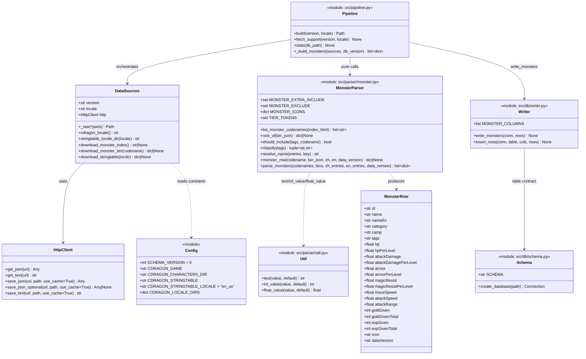
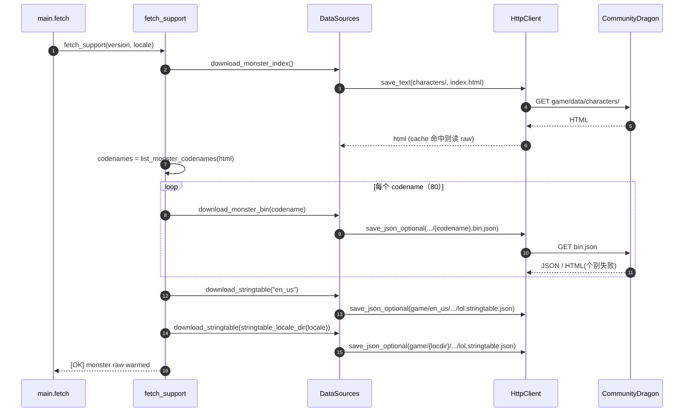
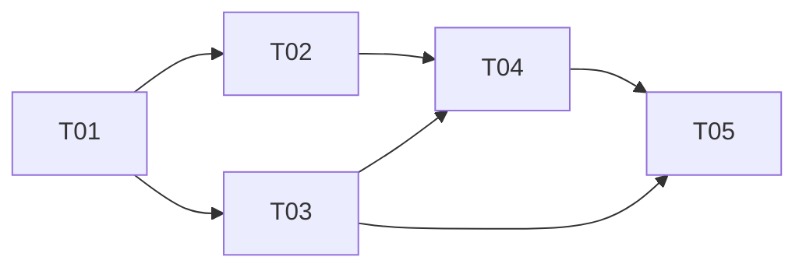

# 野怪（Monster）ETL 设计文档

> 目标仓库：`lol-assistant-data`（Python ETL → SQLite → Android Room）
> 产出：单表 `monster`，schema **v5**（**v7 增列 `effect`/`effectEn`，并新增 `monster_buff` 表**，见 §15）；只做 ETL 侧，不改 Android 仓库 `lolok`。
> 本文档所有关键事实（字段名、图标名、筛选命中、本地化解析）均已用 venv Python + requests 实测复核，结论内联标注。

---

## 0. 结论摘要（TL;DR）

| 项 | 结论 |
| --- | --- |
| 数据源 A | CommunityDragon `game/data/characters/` 目录 + `sru_*/sru_*.bin.json` 的 `CharacterRecords/Root` |
| 数据源 B | CommunityDragon `game/{loc}/data/menu/en_us/lol.stringtable.json`（zh_cn / en_us 两份，各约 32MB） |
| 数据源 C | CommunityDragon `game/assets/characters/{codename}/hud/*_circle*.png`（**命名不规则，须硬编码映射表**） |
| 收录规则 | 词元含 `Monster` **且** 含 `Monster_Camp`，再叠 1 条显式补入 + 2 条显式排除 → **27 行** |
| 分类派生 | `category`：`Monster_Epic > Monster_Large > Monster_Medium > 其它=small` |
| 营地派生 | `camp`：取 `Monster_<X>` 标签（`X∉{Epic,Large,Medium,Small,Camp,Buff}`），小写化 |
| 名称 | `name` ← 构建 locale 的 stringtable；`nameEn` ← `en_us` stringtable；查不到 → 空串（不编造） |
| fetch/build | fetch 联网暖 `raw/<version>/<locale>/...`；build 只读 raw 离线复跑，缺失降级 `[WARN]` 不中断 |
| 中间产物 | **不新增** `cache/monster_*.json`；build 直读 `raw/`（理由见 §7） |
| 版本 | `config.SCHEMA_VERSION = 5`；`meta.schema_version` 自动随常量更新 |

---

## 1. 数据源与实测结论

### 1.1 数据源 A：CommunityDragon 野怪 BIN

| 项 | 值（实测） |
| --- | --- |
| 目录列表 | `https://raw.communitydragon.org/{version}/game/data/characters/`（HTML，约 312KB，`content-type: text/html`） |
| 目录枚举正则 | `href="(sru[^"]+/)"` → 去尾 `/` → 去重排序，共 **80** 个 `sru_*` |
| 单体数据 | `.../game/data/characters/{codename}/{codename}.bin.json` |
| 取值路径 | 顶层键 `Characters/<CODE>/CharacterRecords/Root`（`<CODE>` 如 `SRU_Baron`） |

**`Root` 字段（已逐单位复核，均为 `.baseValue` 包装的 ModifiableFloat，除非注明）：**

| Root 键 | 类型 | 说明 |
| --- | --- | --- |
| `baseHPModifiable` | ModifiableFloat | 基础血量 |
| `hpPerLevelModifiable` | ModifiableFloat | 每级血量成长（**部分单位没有**） |
| `baseDamageModifiable` | ModifiableFloat | 基础攻击力 |
| `damagePerLevelModifiable` | ModifiableFloat | 每级攻击成长（部分单位没有） |
| `baseArmorModifiable` | ModifiableFloat | 基础护甲 |
| `armorPerLevelModifiable` | ModifiableFloat | 每级护甲成长（部分单位没有） |
| `baseMR` | ModifiableFloat | 基础魔抗（注意键名不是 `baseMRModifiable`） |
| `mrPerLevel` | ModifiableFloat | 每级魔抗成长（部分单位没有） |
| `baseMoveSpeedModifiable` | ModifiableFloat | 移速 |
| `attackSpeedModifiable` | ModifiableFloat | 攻速（**所有目标单位都有**） |
| `attackRangeModifiable` | ModifiableFloat | 攻击距离（所有目标单位都有） |
| `goldGivenOnDeath` | 裸 float | 击杀金币（个人） |
| `globalGoldGivenOnDeath` | 裸 float | 团队金币 |
| `expGivenOnDeath` | 裸 float | 击杀经验（个人） |
| `globalExpGivenOnDeath` | 裸 float | 团队经验 |
| `unitTagsString` | 字符串 | 完整标签串，`" | "` 分隔 |
| `name` | 字符串 | 本地化键，形如 `game_character_displayname_Baron` |
| `mCharacterName` | 字符串 | 单位名（**大小写不规则，不用于主键**） |

**实测关键坑（务必按此实现）：**

1. **字段非全集**。例：`sru_gromp` **无** `hpPerLevelModifiable / damagePerLevelModifiable / armorPerLevelModifiable / mrPerLevel`（小怪/部分大型无每级成长）；`sru_horde_mini` **无** `baseMR / armorPerLevelModifiable / mrPerLevel`。**缺失一律取 0，绝不编造**。
2. **无攻速每级字段**。所有单位都没有 `attackSpeedPerLevel*`，故不设计该列（见 §5）。
3. **`baseStaticHPRegenModifiable` 恒为 0**，且需求边界未要求回血 → **不纳入 schema**。
4. **少数 `bin.json` 抓取会失败返回 HTML**（已复现：`sru_dragon_party`、`sruap_chaosnexus`、`sruap_ordernexus`、`sruap_turret_chaos1`、`sruap_turret_order1`）。解析器必须**单条失败降级跳过**，绝不中断整个 build。
5. **UA 复核**：team-lead 提示“CDragon 需浏览器 UA”，实测 **不成立**。现有 `HttpClient` 的默认 UA `lol-assistant-data/1.0` 对 index / bin / stringtable 三类端点均返回 **HTTP 200**（浏览器 UA 那次失败是沙箱瞬时 SSL EOF，非 UA 问题）。→ **`src/downloader/http.py` 无需改动**。

**baron 实测样本**：`baseHP=16300 / hpPerLevel=170 / AD=175 / ADlv=20 / armor=34 / armorLv=8 / MR=32 / mrLv=4 / MS=300 / range=900 / AS=0.625 / gold=100 / globalGold=150 / exp=0 / globalExp=650`，`tags="Monster | Monster_Epic | Special_Void | Monster_Camp | Monster_Baron"`（与 team-lead 侦察一致，本条已验证含 `armorPerLevelModifiable`/`mrPerLevel`）。

### 1.2 数据源 B：本地化名称 stringtable

| 项 | 值（实测） |
| --- | --- |
| URL | `.../game/{loc}/data/menu/en_us/lol.stringtable.json`，中文 `loc=zh_cn`、英文 `loc=en_us`（**不是 `default`**） |
| 结构 | `{"entries": {键: 值}, "version": 5}`；zh 136587 条 / en 136630 条，文件约 **32MB** |
| 取值键 | `Root.name` 的 **小写** 形式 |

**实测解析结果（全部命中，逐条已核）：**

| codename | 键 | zh `name` | en `nameEn` |
| --- | --- | --- | --- |
| sru_baron | `game_character_displayname_Baron` | 纳什男爵 | Baron Nashor |
| sru_dragon | `..._SRUDragon` | 巨龙 | Dragon |
| sru_dragon_air | `..._SRUDragon_Air` | 云霄亚龙 | Cloud Drake |
| sru_dragon_chemtech | `..._SRUDragon_Chemtech` | 炼金科技亚龙 | Chemtech Drake |
| sru_dragon_earth | `..._SRUDragon_Earth` | 山脉亚龙 | Mountain Drake |
| sru_dragon_elder | `..._SRUDragon_Elder` | 远古巨龙 | Elder Dragon |
| sru_dragon_fire | `..._SRUDragon_Fire` | 炼狱亚龙 | Infernal Drake |
| sru_dragon_hextech | `..._SRUDragon_Hextech` | 海克斯科技亚龙 | Hextech Drake |
| sru_dragon_water | `..._SRUDragon_Water` | 海洋亚龙 | Ocean Drake |
| sru_gromp | `..._Gromp` | 魔沼蛙 | Gromp |
| sru_blue | `..._SRUBlue` | 苍蓝雕纹魔像 | Blue Sentinel |
| sru_bluemini | `..._SRUBlueMini` | 苍蓝哨戒 | Sentry |
| sru_bluemini2 | `..._SRUBlueMini`（同键） | 苍蓝哨戒 | Sentry |
| sru_red | `..._SRURed` | 绯红印记树怪 | Red Brambleback |
| sru_redmini | `..._SRURedMini` | 绯红树怪 | Cinderling |
| sru_krug | `..._SRUKrug` | 远古石甲虫 | Ancient Krug |
| sru_krugmini | `..._SRUKrugMini` | 石甲虫 | Krug |
| sru_krugminimini | `..._SRUKrugMiniMini` | 小型石甲虫 | Mini Krug |
| sru_crab | `..._Sru_Crab` | 峡谷迅捷蟹 | Rift Scuttler |
| sru_murkwolf | `..._SRUMurkwolf` | 大型暗影狼 | Greater Murk Wolf |
| sru_murkwolfmini | `..._SRUMurkwolfMini` | 暗影狼 | Murk Wolf |
| sru_razorbeak | `..._SRURazorbeak` | 深红锋喙鸟 | Crimson Raptor |
| sru_razorbeakmini | `..._SRURazorbeakMini` | 锋喙鸟 | Raptor |
| sru_riftherald | `..._SRU_RiftHerald` | 峡谷先锋 | Rift Herald |
| sru_atakhan | `..._SRU_Atakhan` | 厄塔汗 | Atakhan |
| sru_horde | `..._SRU_Horde` | 虚空巢虫 | Voidgrubs |
| sru_horde_mini | `..._SRU_Horde_Mini` | 虚空蠕虫 | Voidmites |
| sru_jungle_companions | `` （**空**） | （空） | （空） |
| sru_riftherald_mercenary | `..._SRU_RiftHerald`（与先锋同键，重名） | 峡谷先锋 | Rift Herald |

> 注：需求文案写“虚空幼虫”，CDragon 实际为 `虚空巢虫 / Voidgrubs`（小虫为 `虚空蠕虫 / Voidmites`）。**以数据为准，不编造**。

**兜底规则**：`Root.name` 为空 → `name=""` 且 `nameEn=""`；键在表中查不到 → 同样空串。

### 1.3 数据源 C：图标（复核后定稿）

**结论：图标文件名不规则，无法用“去掉 `sru_` 前缀”等派生规则得到，必须用硬编码映射表。** 实测列举：

| codename | `hud/` 下的 circle 文件 | 备注 |
| --- | --- | --- |
| sru_baron | `baron_circle.png` | |
| sru_dragon | `dragon_circle.png` | |
| sru_dragon_air | `dragon_air_circle.png` | 前缀式 |
| sru_dragon_fire | `dragon_circle_fire.png` | **后缀式（与 air 不同）** |
| sru_dragon_water | `dragon_circle_water.png` | 后缀式 |
| sru_dragon_earth | `dragon_circle_earth.png` | 后缀式 |
| sru_dragon_elder | `dragon_circle_elder.png` | 后缀式 |
| sru_dragon_chemtech | `hud/icons2d/dragon_circle_chemtech.png` | **在 `icons2d/` 子目录** |
| sru_dragon_hextech | `hud/icons2d/dragon_circle_hextech.png` | 在 `icons2d/` 子目录 |
| sru_gromp | `gromp_circle.png` | |
| sru_blue | `bluesentinel_circle.png` | **文件名与 codename 无关** |
| sru_bluemini | `sentry_circle.png` | **无关** |
| sru_bluemini2 | —（无 `hud/` 目录） | 仅 `skins/` |
| sru_red | `brambleback_circle.png` | **无关** |
| sru_redmini | `cinderling_circle.png` | **无关** |
| sru_krug | `ancientkrug_circle.png` | **无关** |
| sru_krugmini | `krug_circle.png` | **无关** |
| sru_krugminimini | —（无 `hud/` 目录） | 仅 `skins/` |
| sru_crab | `crab_circle_0.png` | **带 `_0` 后缀** |
| sru_murkwolf | `greatermurkwolf_circle.png` | **无关** |
| sru_murkwolfmini | `murkwolf_circle.png` | **无关** |
| sru_razorbeak | `razorbeak_circle.png` | |
| sru_razorbeakmini | `razorbeakmini_circle.png` | |
| sru_riftherald | `sruriftherald_circle.png` | **无下划线** |
| sru_atakhan | `atakhan_v_circle_128.png` / `atakhan_r_circle_128.png` / `atakhan_t_circle_128.png` | **无唯一 `_circle.png`，三者含义未知** |
| sru_horde | `sru_voidgrub_circle.png` | **保留 `sru_` 前缀** |
| sru_horde_mini | `sru_voidmite_circle.png` | **保留 `sru_` 前缀** |

**定稿策略（不编造）**：
- 用**硬编码映射表** `MONSTER_ICONS`（codename → 相对 CDragon `game/` 根的资源路径），值全部经 HEAD/目录枚举验证存在。
- 无 circle 图标者（`sru_bluemini2`、`sru_krugminimini`、`sru_atakhan`）→ `icon = ""`（与其它表“查不到就用空串、绝不编造”一致）。
- 存储形态：相对路径 `assets/characters/{codename}/hud/...png`；App 侧拼 `https://raw.communitydragon.org/{channel}/game/` + `icon`。见 §13 待明确（路径约定需与 Android 侧对齐）。

---

## 2. 收录范围与筛选规则（最终版）

### 2.1 规则（确定性）

```
输入：codename 列表（来自目录枚举，仅 sru_ 前缀 = 召唤师峡谷）
1) 读取 Root.unitTagsString，按 " | " 切词，去空白与空项 → tokens
2) 命中条件： "Monster" ∈ tokens  AND  "Monster_Camp" ∈ tokens
3) 叠加显式补入 MONSTER_EXTRA_INCLUDE
4) 叠加显式排除 MONSTER_EXCLUDE
5) 两次 build 结果一致：codenames 排序后遍历
```

```python
TIER_TOKENS = {"Monster_Epic", "Monster_Large", "Monster_Medium", "Monster_Small"}
CAMP_IGNORE_TOKENS = {"Monster_Camp", "Monster_Buff"} | TIER_TOKENS
# CAMP 标签 = tokens 中以 "Monster_" 开头、去掉前缀后不在 CAMP_IGNORE 的项

MONSTER_EXTRA_INCLUDE = {
    "sru_horde_mini",          # 虚空蠕虫：虚空巢虫的附属小怪，缺 Monster_Camp，用户要求收录
}
MONSTER_EXCLUDE = {
    "sru_jungle_companions",   # 打野伴生宠，非营地野怪；且 Root.name 为空（无中英文名）
    "sru_dragon_ruined",       # 腐朽亚龙：历史遗留龙，不在当前 SR 元素龙名录（用户仅列“各元素亚龙+远古巨龙”）
}
```

### 2.2 命中清单（实测校验）

`Monster ∧ Monster_Camp` 共 28 条：`atakhan, baron, blue, bluemini, bluemini2, crab, dragon, dragon_air, dragon_chemtech, dragon_earth, dragon_elder, dragon_fire, dragon_hextech, dragon_water, dragon_ruined, gromp, horde, jungle_companions, krug, krugmini, krugminimini, murkwolf, murkwolfmini, razorbeak, razorbeakmini, red, redmini, riftherald`。
去掉 `MONSTER_EXCLUDE` 两条（jungle_companions、dragon_ruined），加回 `sru_horde_mini` → **最终 27 行**，与需求“约 30 条”吻合。

| 分组 | codename | category | camp |
| --- | --- | --- | --- |
| 史诗 | sru_baron | epic | baron |
| 史诗 | sru_dragon | epic | dragon |
| 史诗 | sru_dragon_air/fire/water/earth/chemtech/hextech | epic | dragon |
| 史诗 | sru_dragon_elder | epic | dragon |
| 史诗 | sru_riftherald | epic | riftherald |
| 史诗 | sru_atakhan | epic | atakhan |
| 史诗 | sru_horde | epic | horde |
| 附属 | sru_horde_mini | small | horde |
| 大型 | sru_blue | large | blue |
| 附属 | sru_bluemini, sru_bluemini2 | small | blue |
| 大型 | sru_red | large | red |
| 附属 | sru_redmini | small | red |
| 大型 | sru_gromp | large | gromp |
| 大型 | sru_krug | large | krug |
| 中型 | sru_krugmini | medium | krug |
| 附属 | sru_krugminimini | small | krug |
| 大型 | sru_murkwolf | large | wolf |
| 附属 | sru_murkwolfmini | small | wolf |
| 大型 | sru_razorbeak | large | raptor |
| 附属 | sru_razorbeakmini | small | raptor |
| 大型 | sru_crab | large | crab |

> **注：`sru_riftherald_mercenary` 被自然排除** —— 实测其 `tags="Monster | Monster_Epic | Monster_Large | Special_Void"` **不含 `Monster_Camp`**；且其 `name` 键与先锋相同（重名），据此**不纳入**（与 team-lead 侦察结论的差异已更正）。

### 2.3 需明确排除的噪声（由“仅枚举 `sru_` + 必须含 `Monster_Camp`”双重保证）

SR 小兵 `Minion_*`、防御塔/水晶/枢纽 `Structure_*`、植物与守卫 `Ward|Plant`、商店/横幅/道具 `Special`/`IsolationNonImpacting`/`*_prop`/`*_crown` —— 均不含 `Monster_Camp`，天然排除。

---

## 3. 分类与营地类型派生规则

### 3.1 `category`（按优先级取首个命中，确定性）

| 命中词元（优先级从上到下） | category |
| --- | --- |
| `Monster_Epic` | `epic` |
| `Monster_Large` | `large` |
| `Monster_Medium` | `medium` |
| 其它（含 `Monster_Small` / 无档位） | `small` |

> `sru_riftherald`、`sru_horde` 同时含 `Epic` 与 `Large`，按优先级 → `epic`（符合需求：先锋、虚空巢虫为史诗）。

### 3.2 `camp`（取唯一 `Monster_<X>` 非档位标签）

规则：`[t for t in tokens if t.startswith("Monster_") and t not in CAMP_IGNORE_TOKENS]` 取**首个** → 去掉 `Monster_` 前缀并小写。

| `Monster_<X>` | camp | 中文（用户口径） |
| --- | --- | --- |
| `Monster_Baron` | `baron` | 男爵 |
| `Monster_Dragon` | `dragon` | 亚龙（含元素龙/远古巨龙） |
| `Monster_RiftHerald` | `riftherald` | 峡谷先锋 |
| `Monster_Atakhan` | `atakhan` | 厄塔汗 |
| `Monster_Horde` | `horde` | 虚空巢虫 |
| `Monster_Blue` | `blue` | 蓝霸符 |
| `Monster_Red` | `red` | 红霸符 |
| `Monster_Gromp` | `gromp` | 魔沼蛙 |
| `Monster_Krug` | `krug` | 石甲虫 |
| `Monster_Wolf` | `wolf` | 暗影狼 |
| `Monster_Raptor` | `raptor` | 锋喙鸟 |
| `Monster_Crab` | `crab` | 迅捷蟹 |

- `Monster_Buff`（blue/red 均带）**被忽略**，以得到更细的 `blue`/`red`（二者即“霸符”两类）。
- **未知标签兜底**：无任何合法 `Monster_<X>` 标签 → `camp=""`（空串，不猜）。当前 27 条均有唯一值。
- 遇多个合法 camp 标签 → 取**标签串中首个**（确定性）。当前 27 条均无此情况。

---

## 4. 本地化名解析

| 步骤 | 规则 |
| --- | --- |
| 键 | `key = Root.name`（原样）；`lookup = key.lower()` |
| `name`（本地名） | 构建 locale 的 stringtable `entries[lookup]`；查不到 → `""` |
| `nameEn`（英文） | `en_us` stringtable `entries[lookup]`；查不到 → `""` |
| `Root.name` 为空 | `name = nameEn = ""` |
| locale 归并 | 若构建 locale 就是 `en_US`，两份表合并为一次查找（`name == nameEn`） |

- 依赖：fetch 阶段必须**同时**暖好「构建 locale 的表」与「`en_us` 的表」（见 §7）。
- stringtable 目录名 = `locale.lower()`（`en_US→en_us`、`zh_CN→zh_cn`），**与 `CDRAGON_LOCALE_DIRS`（`en_US→default`）不同，严禁混用**。

---

## 5. Schema v5 完整 DDL

版本管理：`config.SCHEMA_VERSION = 4 → 5`；`pipeline.build()` 已用 `write_meta({... "schema_version": str(SCHEMA_VERSION) ...})` 写入 `meta`，故**只改常量即自动生效**。

```sql
-- 野怪（召唤师峡谷）。风格与现有表一致：列名 camelCase、全部 NOT NULL、
-- 数值缺省 0、文本缺省 ''。数据源：CommunityDragon characters BIN（无换行/无派生）。
CREATE TABLE monster (
    id                  TEXT    PRIMARY KEY NOT NULL,  -- codename，如 'sru_baron'
    name                TEXT    NOT NULL,              -- 本地化名（构建 locale）
    nameEn              TEXT    NOT NULL,              -- 英文名
    category            TEXT    NOT NULL,              -- epic|large|medium|small
    camp                TEXT    NOT NULL,              -- baron|dragon|riftherald|atakhan|horde|blue|red|gromp|krug|wolf|raptor|crab
    tags                TEXT    NOT NULL,              -- 完整 unitTagsString
    hp                  REAL    NOT NULL,              -- baseHPModifiable
    hpPerLevel          REAL    NOT NULL,              -- hpPerLevelModifiable
    attackDamage        REAL    NOT NULL,              -- baseDamageModifiable
    attackDamagePerLevel REAL   NOT NULL,              -- damagePerLevelModifiable
    armor               REAL    NOT NULL,              -- baseArmorModifiable
    armorPerLevel       REAL    NOT NULL,              -- armorPerLevelModifiable
    magicResist         REAL    NOT NULL,              -- baseMR
    magicResistPerLevel REAL    NOT NULL,              -- mrPerLevel
    moveSpeed           REAL    NOT NULL,              -- baseMoveSpeedModifiable
    attackSpeed         REAL    NOT NULL,              -- attackSpeedModifiable
    attackRange         REAL    NOT NULL,              -- attackRangeModifiable
    goldGiven           INTEGER NOT NULL,              -- goldGivenOnDeath      （个人金币）
    goldGivenTotal      INTEGER NOT NULL,              -- globalGoldGivenOnDeath（团队金币）
    expGiven            INTEGER NOT NULL,              -- expGivenOnDeath       （个人经验）
    expGivenTotal       INTEGER NOT NULL,              -- globalExpGivenOnDeath （团队经验）
    icon                TEXT    NOT NULL,              -- 相对 CDragon game/ 根的资源路径；无图 = ''
    dataVersion         TEXT    NOT NULL               -- 数据版本（= db_version，如 '16.20'）
);

CREATE INDEX idx_monster_name     ON monster(name);
CREATE INDEX idx_monster_camp     ON monster(camp);
CREATE INDEX idx_monster_category ON monster(category);
```

**设计说明**
- 与现有风格一致：`id TEXT PRIMARY KEY`（对齐 `champion.id`/`summoner_spell.id`）；战斗属性用 `REAL`（对齐 `champion` 数值列）；奖励用 `INTEGER`（对齐 `item.goldTotal`/`summoner_spell.cooldown`）；文本列用 `TEXT`。
- **不建** `monster_spell`（需求明确排除）。
- **不建** 回血列、攻速每级列（无数据源，避免恒 0 噪声列）。
- `goldGiven` 等奖励经 `int_value()` 取整（实测全为整数）；`REAL` 列经 `float_value()`，缺失 → `0.0`。

---

## 6. `monster` 行 dict 字段清单（键 → 来源 → 类型 → 缺省）

| dict 键 | 来源（Root 键 / 其它） | Python 类型 | 缺失缺省 |
| --- | --- | --- | --- |
| `id` | codename（目录名） | str | —（必有） |
| `name` | stringtable(build locale)[`Root.name`.lower()] | str | `""` |
| `nameEn` | stringtable(`en_us`)[`Root.name`.lower()] | str | `""` |
| `category` | §3.1 派生自 `unitTagsString` | str | `"small"`（无档位时） |
| `camp` | §3.2 派生自 `unitTagsString` | str | `""` |
| `tags` | `unitTagsString` | str | `""` |
| `hp` | `baseHPModifiable.baseValue` | float | `0.0` |
| `hpPerLevel` | `hpPerLevelModifiable.baseValue` | float | `0.0` |
| `attackDamage` | `baseDamageModifiable.baseValue` | float | `0.0` |
| `attackDamagePerLevel` | `damagePerLevelModifiable.baseValue` | float | `0.0` |
| `armor` | `baseArmorModifiable.baseValue` | float | `0.0` |
| `armorPerLevel` | `armorPerLevelModifiable.baseValue` | float | `0.0` |
| `magicResist` | `baseMR.baseValue` | float | `0.0` |
| `magicResistPerLevel` | `mrPerLevel.baseValue` | float | `0.0` |
| `moveSpeed` | `baseMoveSpeedModifiable.baseValue` | float | `0.0` |
| `attackSpeed` | `attackSpeedModifiable.baseValue` | float | `0.0` |
| `attackRange` | `attackRangeModifiable.baseValue` | float | `0.0` |
| `goldGiven` | `goldGivenOnDeath` | int | `0` |
| `goldGivenTotal` | `globalGoldGivenOnDeath` | int | `0` |
| `expGiven` | `expGivenOnDeath` | int | `0` |
| `expGivenTotal` | `globalExpGivenOnDeath` | int | `0` |
| `icon` | `MONSTER_ICONS[codename]`（硬编码，§1.3） | str | `""` |
| `dataVersion` | `db_version` | str | —（必有） |

---

## 7. fetch / build 职责划分

| 阶段 | 联网？ | 动作 | 落盘 |
| --- | --- | --- | --- |
| `fetch_support()` | 是 | ① 拉目录 index HTML；② 拉全部 80 个 `sru_*` 的 `bin.json`；③ 拉 2 份 stringtable（构建 locale + `en_us`） | `raw/<version>/<locale>/cdragon/game/...` |
| `build()` | 否（读 raw） | 读 index → 枚举 codename；读各 `bin.json` → 解析/筛选/分类；读 stringtable → 名称；写库 | `output/lol-<version>.db` |

**raw 缓存路径（沿用 `DataSources._raw()` 约定）**

| 内容 | 相对路径 |
| --- | --- |
| 目录索引 | `raw/<version>/<locale>/cdragon/game/data/characters/index.html` |
| 单体 BIN | `raw/<version>/<locale>/cdragon/game/data/characters/<codename>/<codename>.bin.json` |
| stringtable | `raw/<version>/<locale>/cdragon/game/stringtable/<locdir>.lol.stringtable.json`（`locdir ∈ {zh_cn,en_us}`） |

**降级约定（沿用现有 `save_*` 家族）**
- index 缺失 → `[WARN]` 且 monster 段产出空列表，build 正常完成。
- 单个 bin 缺失/非 JSON → `save_json_optional` 返回 `None` → 跳过该单位（`[WARN]`）。
- stringtable 缺失 → 名称全部空串（`[WARN]`），战斗数值不受影响。
- **绝不因任一源缺失而中断 build。**

**是否新增 `cache/monster_*.json`？→ 不新增，build 直读 `raw/`。**
理由：`cache/*.json`（如 `summoner_spells_wiki.json`）之所以存在，是因为 Wiki 数据需**昂贵的联网渲染**（`action=parse`），build 不应重复。而野怪全部数据（BIN + stringtable）都是**廉价、确定性**的本地解析，无需中间产物；直读 `raw/` 与现有 `download_character_bin`（build 时 cache-first 读 raw）模式一致，且减少一份可变状态。

---

## 8. 模块与文件清单

| 文件（相对路径） | 动作 | 职责（一句话） |
| --- | --- | --- |
| `config.py` | 改 | `SCHEMA_VERSION=5`；新增 `CDRAGON_CHARACTERS_DIR`、`CDRAGON_STRINGTABLE`、stringtable locale 目录常量。 |
| `src/downloader/sources.py` | 改 | 新增 `download_monster_index()` / `download_monster_bin(codename)` / `download_stringtable(locdir)` + `stringtable_locale_dir()`。 |
| `src/parser/util.py` | 改 | 新增 `float_value()`（对齐 `int_value()`，容错取浮点）。 |
| `src/parser/monster.py` | **新增** | 纯函数：枚举 codename、筛选/分类/营地派生、名称解析、行构造、图标表、`parse_monsters()`。 |
| `src/db/schema.py` | 改 | `SCHEMA` 中追加 `monster` 表与三个索引。 |
| `src/db/writer.py` | 改 | 新增 `MONSTER_COLUMNS` 与 `write_monsters(conn, rows)`。 |
| `src/pipeline.py` | 改 | `build()` 集成 monster 段；`fetch_support()` 暖 raw；`stats()` 表清单加 `monster`。 |
| `src/main.py` | 改（可选） | `inspect` 增加 `--monster`（可选，见 §13）。 |
| `tests/test_monster.py` | **新增** | 覆盖枚举/筛选/分类/字段映射/名称兜底/确定性。 |
| `README.md` | 改 | schema v4→v5；表格加 `monster`；补野怪数据源与 fetch/build 说明。 |

---

## 9. 数据结构与接口

### 9.1 类图（classDiagram）



### 9.2 `DataSources` 新增方法签名

```python
def stringtable_locale_dir(self, locale: str) -> str:
    """CDragon stringtable 目录名 = locale.lower()（en_US->en_us），
    与 cdragon_locale()（en_US->default）区分开。"""

def download_monster_index(self) -> str | None:
    """GET {CDRAGON_CHARACTERS_DIR} → raw/<v>/<loc>/cdragon/game/data/characters/index.html
    返回 HTML 文本；失败返回 None（降级）。"""

def download_monster_bin(self, codename: str) -> dict | None:
    """GET .../characters/{codename}/{codename}.bin.json →
    raw/<v>/<loc>/cdragon/game/data/characters/{codename}/{codename}.bin.json
    用 save_json_optional；单条失败返回 None（跳过）。"""

def download_stringtable(self, locdir: str) -> dict | None:
    """GET .../game/{locdir}/data/menu/en_us/lol.stringtable.json →
    raw/<v>/<loc>/cdragon/game/stringtable/{locdir}.lol.stringtable.json
    返回 {'entries': {...}, 'version': 5}；失败返回 None。"""
```

### 9.3 `src/parser/monster.py` 关键函数签名

```python
def list_monster_codenames(index_html: str) -> list[str]:
    """正则 href="(sru[^"]+/)" → 去尾'/' → 去重排序。"""

def root_of(bin_json: dict | None) -> dict | None:
    """取首个以 'CharacterRecords/Root' 结尾的顶层键的值。"""

def should_include(tags: str, codename: str) -> bool:
    """tokens 含 Monster ∧ Monster_Camp；再叠 EXTRA_INCLUDE / EXCLUDE。"""

def classify(tags: str) -> tuple[str, str]:
    """返回 (category, camp)，规则见 §3。"""

def resolve_name(entries: dict[str, str] | None, key: str) -> str:
    """entries.get(key.lower(), '')；key 为空 → ''。"""

def monster_row(codename, bin_json, zh_entries, en_entries, data_version) -> dict | None:
    """单条组装；root 缺失 / 不满足 include → None。"""

def parse_monsters(codenames, bins, zh_entries, en_entries, data_version) -> list[dict]:
    """遍历（codenames 已排序），跳过 None，返回行列表。"""
```

---

## 10. 程序调用流程

### 10.1 fetch（联网暖 raw）



### 10.2 build（离线复跑）

```mermaid
sequenceDiagram
    autonumber
    participant CLI as main.build
    participant P as pipeline.build
    participant DS as DataSources
    participant MP as parser.monster
    participant W as db.writer
    participant DB as SQLite

    CLI->>P: build(version, locale)
    P->>DS: download_monster_index()  %% cache-first -> 离线读 raw
    DS-->>P: index_html | None
    alt index 缺失
        P->>P: [WARN] monster 段跳过
    else 正常
        P->>MP: list_monster_codenames(index_html)
        MP-->>P: codenames (sorted)
        loop 每个 codename
            P->>DS: download_monster_bin(codename)
            DS-->>P: bin_json | None
        end
        P->>DS: download_stringtable("en_us"); download_stringtable(locale_dir)
        DS-->>P: en_entries, zh_entries
        P->>MP: parse_monsters(codenames, bins, zh, en, db_version)
        MP->>MP: root_of -> should_include -> classify -> resolve_name -> monster_row
        MP-->>P: rows (27)
        P->>W: write_monsters(conn, rows)
        W->>DB: INSERT OR REPLACE INTO monster ...
    end
    P->>W: write_meta(schema_version="5", ...)
    P->>DB: commit + VACUUM
```

---

## 11. 任务列表（按实现顺序，含依赖）

> 共 **5 个任务**（≤5 硬性上限）；每条具体到“改哪个文件的哪个函数”。

| ID | 任务名 | 源文件 | 依赖 | 优先级 |
| --- | --- | --- | --- | --- |
| **T01** | 基础设施：schema v5 + 常量 + util | ① `config.py`：`SCHEMA_VERSION=5`；新增 `CDRAGON_CHARACTERS_DIR = CDRAGON_GAME + "/data/characters/"`、`CDRAGON_STRINGTABLE = CDRAGON_GAME + "/{locdir}/data/menu/en_us/lol.stringtable.json"`、`CDRAGON_STRINGTABLE_LOCALE="en_us"`。② `src/db/schema.py`：在 `SCHEMA` 追加 `monster` 表 DDL + 3 索引（§5）。③ `src/parser/util.py`：新增 `float_value(value, default=0.0)`。 | — | P0 |
| **T02** | 下载层：CDragon 野怪三端点 | `src/downloader/sources.py`：新增 `stringtable_locale_dir()`、`download_monster_index()`、`download_monster_bin()`、`download_stringtable()`（§9.2）；导入 §T01 新常量。 | T01 | P0 |
| **T03** | 解析层：分区/筛选/名称/行构造 | **新增** `src/parser/monster.py`：常量（`MONSTER_EXTRA_INCLUDE`/`MONSTER_EXCLUDE`/`MONSTER_ICONS`/`TIER_TOKENS`）+ 函数（`list_monster_codenames`/`root_of`/`should_include`/`classify`/`resolve_name`/`monster_row`/`parse_monsters`）（§9.3）；`import float_value`。 | T01 | P0 |
| **T04** | 写库与流水线集成 | ① `src/db/writer.py`：新增 `MONSTER_COLUMNS` + `write_monsters()`。② `src/pipeline.py`：`build()` 加 `_build_monsters(sources, db_version)` 调用与 `write_monsters`、`print("[INFO] monsters=...")`；`fetch_support()` 加 index/bins/stringtables 暖 raw 与 `[OK]` 打印；`stats()` 表清单加 `"monster"`。③ `src/main.py`：`inspect` 增 `--monster`（可选）。 | T01,T02,T03 | P0 |
| **T05** | 测试与文档 | **新增** `tests/test_monster.py`（§14 用例）；`README.md` 更新（schema v5、`What gets built` 加 `monster` 行、补 fetch/build 说明）；清理仓库根 `_probe_*.py`（见 §13）。 | T03,T04 | P1 |

**并行性**：T02 与 T03 互相独立，均只依赖 T01，可并行开发。



---

## 12. 共享知识 / 跨文件约定

- **locale 双映射，切勿混用**：
  - v1 插件目录：`CDRAGON_LOCALE_DIRS`（`en_US→default`），走 `cdragon_locale()`。
  - **stringtable**：`game/{locdir}/data/menu/en_us/...`，`locdir = locale.lower()`（`en_US→en_us`、`zh_CN→zh_cn`），走 `stringtable_locale_dir()`。
- **缺失即降级，绝不编造**：数值缺 → `0`/`0.0`；文本缺 → `""`；单条 BIN 失败 → 跳过；整段数据源缺失 → 空列表 + `[WARN]`，build 仍成功。
- **确定性**：`codenames` 排序后遍历；`classify` 取“标签串首个”命中；`camp` 取唯一合法标签。→ **`monster` 表内容对同一版本可复现**。
  - ⚠️ 既有约束：`meta.generated_at` 与 `latest.json.generatedAt` 为墙钟时间，故“整库文件逐字节一致”本就被破坏（既有行为）。**确定性要求仅约束 `monster` 表内容**（本设计满足）。
- **BIN 取值**：`ModifiableFloat` 一律取 `node["baseValue"]`；裸值直接取。键缺失 → 缺省。**不**改 `base_stats.py`（那是 champion 专用映射，含 `hpRegen` 排除逻辑）。
- **不新增 cache 中间产物**；build 直读 `raw/`（§7）。
- **图标**：`icon` = 相对 CDragon `game/` 根的资源路径（`assets/characters/.../hud/...png`）；无图 = `""`。App 侧拼 `{CDRAGON_BASE}/{channel}/game/` + `icon`。
- **数据版本**：`dataVersion = db_version`（= Data Dragon 版本号，如 `16.20`），与 `champion_spell.dataVersion` 语义一致。

---

## 13. 待明确事项（需用户/主理人拍板）

| # | 事项 | 建议默认 | 影响 |
| --- | --- | --- | --- |
| 1 | `sru_dragon_ruined`（腐朽亚龙）是否收录？ | **排除**（不在当前 SR 元素龙名录） | +1 行；翻转即移出 `MONSTER_EXCLUDE` |
| 2 | `sru_jungle_companions`（打野伴生宠）是否收录？ | **排除**（非营地野怪；`Root.name` 为空） | +1 行 |
| 3 | `sru_atakhan` 图标：无唯一 `_circle.png`，仅 `atakhan_{v,r,t}_circle_128.png` | `icon=""` | 若需图标，请指定采用哪个变体 |
| 4 | `sru_bluemini2` / `sru_krugminimini` 无独立 circle；兄弟单位 (`sru_bluemini/hud/sentry_circle.png`) 有 | `icon=""`；可选：显式复用兄弟图标 | 3 个 icon 空串 |
| 5 | 图标路径存储形态：相对 `game/` 根路径 vs 裸文件名 | 相对路径（含 `assets/characters/...`） | 需与 Android `lolok` 侧对齐拼 URL 约定 |
| 6 | `name` 语义：始终为“构建 locale 名”，`nameEn` 恒为英文 | 是 | 若需固定中文名，请说明 |
| 7 | 需求文案“虚空幼虫”，CDragon 实为“虚空巢虫/Voidgrubs” | **以数据为准** | 文案差异 |
| 8 | 是否扩展 `inspect --monster` 调试入口 | 加（T04 可选） | 仅调试便利性 |
| 9 | 仓库根遗留 `_probe_*.py` 与 `_monster_dump.json` 侦察脚本 | T05 清理（加入 `.gitignore` 或删除） | 仓库整洁 |

---

## 14. 测试用例清单（T05，`tests/test_monster.py`）

| 用例 | 断言 |
| --- | --- |
| `list_monster_codenames` | 给定含 `href="sru_baron/"`、`href="sruap_x/"` 的 HTML → 仅返回 `sru_*` 且去重排序 |
| `should_include` 正向 | baron（Monster+Camp）→ True |
| `should_include` 负向 | 小兵 `Minion|Minion_Lane` → False |
| `should_include` 补入 | `sru_horde_mini`（仅 `Monster_Horde`）→ True（EXTRA_INCLUDE） |
| `should_include` 排除 | `sru_jungle_companions`（含 Camp）→ False（EXCLUDE） |
| `classify` 档位优先 | `Monster|Monster_Large|Monster_Epic|...|Monster_Baron` → `("epic","baron")` |
| `classify` 忽略 Buff | `...|Monster_Red|...|Monster_Buff` → `("large","red")` |
| `classify` 兜底 | 未知/空 tags → `("small","")`（不抛异常） |
| `monster_row` 字段映射 | 给 `ModifiableFloat {...baseValue...}` 样本 → 数值解包正确 |
| `monster_row` 缺失取 0 | gromp 无每级字段 → `hpPerLevel==0.0` 等 |
| `resolve_name` 兜底 | 键为空 / 表中无键 → `""` |
| `parse_monsters` 确定性 | 同输入两次调用 → 行列表完全相同（同序） |
| `parse_monsters` 单条失败 | bins 内含 `None` → 该条跳过，其余不受影响 |

---

## 15. schema v7 扩展：击杀说明 `effect` + 奖励 buff 目录 `monster_buff`

> 起因：Android `MonsterEffectPanel`（击杀效果面板）此前只能写「本地数据没有任何效果文案」。
> 实测确认**数据存在**，只是没采 —— 全在客户端字符串表 `zh_cn.lol.stringtable.json`
> （ETL 已为野怪缓存的同一份）。**不新增任何数据源**。

### 15.1 `monster.effect` / `effectEn`（每只野怪的击杀/说明文案）

| 项 | 结论（实测） |
| --- | --- |
| 主源 | `game_character_enemytooltip_<x>`（游戏内「敌方信息」面板，正文含击杀奖励） |
| 兜底 | `game_character_description_<x>`（少数单位只有这个，如**海克斯科技亚龙**） |
| 键派生 | `Root.name`（`game_character_displayname_Baron`）→ 前缀换成 `enemytooltip_`/`description_` 并**小写** → `game_character_enemytooltip_baron` |
| 取哪一段 | 只取 `<mainText>`（`spelltext.main_text`），丢掉 `titleLeft`/`subtitle*`/`postScript*`（免得名字重复） |
| 清洗 | 复用 `spelltext.clean_official_text`（清 `{{ }}`、`%i:`、空成对标记、实体）；**保留**客户端标记与 `@占位符@` |
| **覆盖率** | **22 / 27** |
| 空值 5 只 | `sru_atakhan`（26.1 已移除）、`sru_dragon_chemtech`、`sru_horde`、`sru_horde_mini`、`sru_krugminimini`（客户端就是没有这个键） |

**⚠️ 石甲虫「分裂」在当前文案里没有**：16.20 的 `sru_krug` 敌方信息只有
`击败这个野怪会回复少量的法力值和生命值。`；「在被击杀时分裂为2个普通石甲虫」
只在 **2015 赛季旧键** `game_character_enemytooltip_s2015_srukrug` 里，而分裂机制本身
只是技能 `SpawnMiniKrug_Mis`，**没有文字描述**。→ 不编造，`effect` 保持官方文案。

### 15.2 新表 `monster_buff`（奖励 buff 目录，19 行）

**没有机器可读字段把「奖励 buff」关联到野怪** → 沿用 `MONSTER_ICONS` 的做法：
**硬编码目录 `MONSTER_BUFF_CATALOG`**（`src/parser/monster.py`）给出每条的
`(id, kind, camp, 描述键[, 名称键])`，文案本身从字符串表键取，**不手抄**。

| kind | 条数 | 内容（id → 名称） |
| --- | --- | --- |
| `epic` | 5 | `baron_hand`男爵之手 · `elder_wrath`巨龙威势(含斩杀) · `rift_herald`虚空掠影 · `void_touch`虚空之触 · `void_hunger`虚空之饥饿 |
| `drake` | 6 | `drake_{infernal,cloud,ocean,mountain,chemtech,hextech}`（炼狱/云霄/海洋/山脉/炼金科技/海克斯科技 巨龙） |
| `soul` | 6 | `soul_{infernal,cloud,ocean,mountain,chemtech,hextech}`（六个龙魂） |
| `camp` | 2 | `blue_crest`洞悉之冠(蓝buff) · `red_crest`余烬之冠(红buff) |

* 名称解析：优先描述键的 `<titleLeft>`；没有时回退目录里的 `name_key`
  （**六个龙魂**都是这种，如 `buff_dragonsoulinfernal_name` = 炼狱龙魂）。
* **缺失降级**：本地化描述取不到 → **不建行**（空菜单项没信息，不编造）；
  整张字符串表缺失 → 0 行 + `[WARN]`，build 照常完成。
* **只收现役野怪**：厄塔汗 26.1 已移除，其 2025 赛季奖励（杀戮之冠 / 伪造生命 /
  心灵净化 / 血花瓣）**刻意不入目录**。
* **不建 icon 列**：CommunityDragon 无 `game/data/buffs/`，占位符（`@Spell.X:Y@`）
  离线又算不出 → 目录只承载文字，避免恒空噪声列。

### 15.3 DDL 增量（`SCHEMA_VERSION 6 → 7`）

```sql
-- monster 表新增两列（紧跟 tags）
ALTER ... effect TEXT NOT NULL, effectEn TEXT NOT NULL   -- 见 src/db/schema.py 定稿

CREATE TABLE monster_buff (
    id            TEXT PRIMARY KEY NOT NULL,  -- 稳定键，如 'baron_hand'
    name          TEXT NOT NULL,
    nameEn        TEXT NOT NULL,
    kind          TEXT NOT NULL,              -- epic | drake | soul | camp
    camp          TEXT NOT NULL,              -- 对齐 monster.camp
    description   TEXT NOT NULL,
    descriptionEn TEXT NOT NULL,
    dataVersion   TEXT NOT NULL
);
CREATE INDEX idx_monster_buff_kind ON monster_buff(kind);
CREATE INDEX idx_monster_buff_camp ON monster_buff(camp);
```

> 说明：库每次全量重建，不存在 migration；`inspect --monster` 已顺带打印该营地
> 的 buff 行，`stats` 表清单已加 `monster_buff`。

### 15.4 实测（16.20 / zh_CN）

* `monsters=27 monsterBuffs=19`；`schema_version=7`。
* `effect` 填充 **22/27**，空值正是上表 5 只；`tooltipRendered` 仍 **155**（无回归）。
* **残留审计 0**：`effect*` / `description*` / `name*` 全表无 `{{ }}`、`%i:`、
  `<titleLeft>`、`<postScript`、`<subtitle`、`@@`。
* 目录 19 行**名称与描述均非空**（`name`/`nameEn` 全覆盖）。

### 15.5 落地文件

| 文件 | 改动 |
| --- | --- |
| `config.py` | `SCHEMA_VERSION 6 → 7` |
| `src/db/schema.py` | `monster` 加 `effect`/`effectEn`；新增 `monster_buff` 表 + 2 索引 |
| `src/db/writer.py` | `MONSTER_COLUMNS` 加两列；新增 `MONSTER_BUFF_COLUMNS` + `write_monster_buffs()` |
| `src/parser/spelltext.py` | `_main_text`/`_title_left` 提为公开 `main_text()`/`title_left()`（供野怪复用）；行为不变 |
| `src/parser/monster.py` | 新增 `plain_text`/`official_body`/`monster_effect_keys`/`resolve_effect`；`BuffSpec` + `MONSTER_BUFF_CATALOG` + `buff_name`/`monster_buff_row`/`parse_monster_buffs`；`monster_row` 补两列 |
| `src/pipeline.py` | `_load_monster_stringtables()` 抽出（表只读一次）；`_build_monsters` 返回 `(rows, zh, en)`；`build()` 写 `monster_buff`；`stats`/`inspect` 更新 |
| `tests/test_monster.py` | 新增 11 个用例（effect 派生/取段/兜底、buff 目录名与降级、确定性） |
| `README.md` | schema v6→v7；`What gets built` 加 `monster_buff`；新增 v7 章节 |

### 15.6 未做 / 后续

* **buff 图标**：无稳定来源，留空（Android 侧可先用营地图标）。
* **占位符求值**：`@Spell.SRX_DragonBuffInfernal:ADandAPPercentIncrease*100@` 这类
  跨技能引用离线算不出，**原样存库**交由客户端（同 `tooltipRendered` 的分工）。
* **`champion_spell` 同源的 `@Spell.X:Y@` 求值**仍是已知上游可改进点。

---

## 附：图标映射表（`MONSTER_ICONS` 定稿值，均已实测存在）

```python
MONSTER_ICONS = {
    "sru_baron":          "assets/characters/sru_baron/hud/baron_circle.png",
    "sru_dragon":         "assets/characters/sru_dragon/hud/dragon_circle.png",
    "sru_dragon_air":     "assets/characters/sru_dragon_air/hud/dragon_air_circle.png",
    "sru_dragon_fire":    "assets/characters/sru_dragon_fire/hud/dragon_circle_fire.png",
    "sru_dragon_water":   "assets/characters/sru_dragon_water/hud/dragon_circle_water.png",
    "sru_dragon_earth":   "assets/characters/sru_dragon_earth/hud/dragon_circle_earth.png",
    "sru_dragon_elder":   "assets/characters/sru_dragon_elder/hud/dragon_circle_elder.png",
    "sru_dragon_chemtech":"assets/characters/sru_dragon_chemtech/hud/icons2d/dragon_circle_chemtech.png",
    "sru_dragon_hextech": "assets/characters/sru_dragon_hextech/hud/icons2d/dragon_circle_hextech.png",
    "sru_gromp":          "assets/characters/sru_gromp/hud/gromp_circle.png",
    "sru_blue":           "assets/characters/sru_blue/hud/bluesentinel_circle.png",
    "sru_bluemini":       "assets/characters/sru_bluemini/hud/sentry_circle.png",
    "sru_bluemini2":      "",  # 无独立 hud；见 §13-4
    "sru_red":            "assets/characters/sru_red/hud/brambleback_circle.png",
    "sru_redmini":        "assets/characters/sru_redmini/hud/cinderling_circle.png",
    "sru_krug":           "assets/characters/sru_krug/hud/ancientkrug_circle.png",
    "sru_krugmini":       "assets/characters/sru_krugmini/hud/krug_circle.png",
    "sru_krugminimini":   "",  # 无独立 hud；见 §13-4
    "sru_crab":           "assets/characters/sru_crab/hud/crab_circle_0.png",
    "sru_murkwolf":       "assets/characters/sru_murkwolf/hud/greatermurkwolf_circle.png",
    "sru_murkwolfmini":   "assets/characters/sru_murkwolfmini/hud/murkwolf_circle.png",
    "sru_razorbeak":      "assets/characters/sru_razorbeak/hud/razorbeak_circle.png",
    "sru_razorbeakmini":  "assets/characters/sru_razorbeakmini/hud/razorbeakmini_circle.png",
    "sru_riftherald":     "assets/characters/sru_riftherald/hud/sruriftherald_circle.png",
    "sru_atakhan":        "",  # 变体图标 v/r/t 歧义；见 §13-3
    "sru_horde":          "assets/characters/sru_horde/hud/sru_voidgrub_circle.png",
    "sru_horde_mini":     "assets/characters/sru_horde_mini/hud/sru_voidmite_circle.png",
}
```
