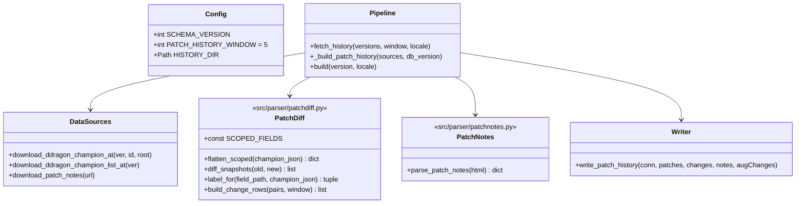
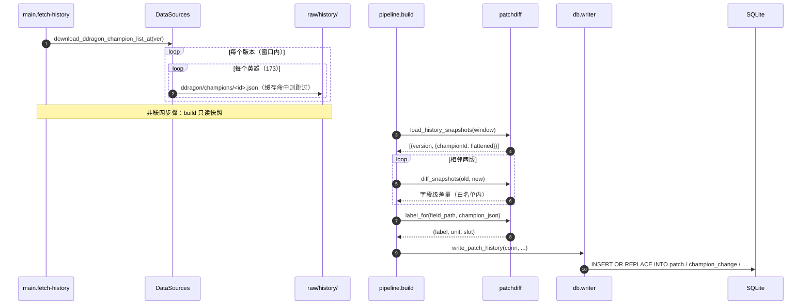

# 英雄版本变更历史（Patch History）ETL 设计

> 目标仓库：`lol-assistant-data`（Python ETL → SQLite → Android Room）
> 本文档为**设计稿**，尚未实现。产出：`patch` / `champion_change` / `champion_change_note` /
> `augment_change` 四张新表。
> 体例对齐 `docs/aram-etl-design.md`、`docs/hextech-aram-etl-design.md`。
>
> **事实标注约定**：✅ **实测**；🟡 **旁证**；⚠️ **待验证**。

---

## 0. 结论摘要（TL;DR）

| 问题 | 答案 |
| --- | --- |
| 数据从哪来？ | **主源 = CDragon/Data Dragon 的双版本快照自算 diff**（✅ 可回溯到 `10.1`）；**辅源 = 官方版本公告文案**（✅ 单页可达、❌ 列表页不可枚举）；Wiki **403 不可用** |
| 为什么不直接抓公告？ | 公告只有「文字」，且列表页不可枚举，中文站点没有版本 API → 不能作为自动化主源；但它是**数值型平衡**（服务端下发、客户端查不到）的唯一权威补充 |
| 为什么不自接 CDragon BIN 做全量 diff？ | ✅ 实测**噪声淹没信号**：Aatrox `16.19 → 16.20` 原始 BIN diff 得到 7 处差异，**全部**是 `EventsToTrack/EventToTrack`（`255 → 257`）这类引擎事件 ID |
| 每次发版要做什么？ | **3 条命令**（§7 SOP），无手写 SQL：`fetch` → `fetch-history` → `build` |
| 幂等？ | `PRIMARY KEY (championId, patchVersion, scope, slot, fieldPath)` + `INSERT OR REPLACE`；DB 每次全量重建，无 migration |
| 体积？ | ✅ 实测：Data Dragon 深 JSON **4.8 MB/版本**（173 英雄）；CDragon 英雄 BIN **22 MB/版本** → 默认只对 Data Dragon 做 diff，`--deep` 才加 BIN |
| 窗口？ | `PATCH_HISTORY_WINDOW = 5`（默认最近 5 个版本），可配 `0` 关闭 |
| 能否判定 buff/nerf？ | **不能自动判定**。diff 只产出客观的 `direction`（变大/变小）；`verdict`（增强/削弱）留给公告文本或人工，**绝不猜**（与项目「绝不编造」原则一致） |

---

## 1. 现实基线：最近这次更新到底改了什么

用户提到的「前两天的更新」= `16.19 → 16.20`。**用自算 diff 实跑出来的真实结果**（✅ 实测，命令见附 B）：

| 英雄 | 差异（字段级） |
| --- | --- |
| `Cassiopeia`（魔蛇之拥） | `stats.hp 630 → 610`、`stats.mp 480 → 450` |
| `Swain`（诺克萨斯统领） | `spells[1].cooldownBurn 22/21/20/19/18 → 20/19/18/17/16`、`stats.armor 25 → 23`、`stats.spellblock 31 → 34` |

全量扫描结果：173 个英雄中**基础属性有改动的只有这 2 个**，其余 0 处差异（`Aatrox`/`Ahri`/`Sona` 的整棵技能树逐叶子比对均为 0）。这就是「英雄近几次更新」要落库的原始素材——**字段路径 + 旧值 + 新值**。

---

## 2. 源选型（全部实测）

| # | 源 | 覆盖内容 | 可达性 | 定位 |
| --- | --- | --- | --- | --- |
| A | **Data Dragon 深 JSON（逐版本）** | 基础属性、技能冷却/耗蓝/射程/描述、被动 | ✅ `16.18/16.19/16.20` 均 200；版本号来自 `api/versions.json` | **主源**（轻、已归一化、本地化） |
| B | **CommunityDragon 逐版本目录** | 游戏 BIN、v1 接口、stringtable | ✅ 版本目录可回溯到 `10.1`（含 `16.19`/`16.20`） | 深源 / 回填 |
| C | 官方版本公告（CN 详情页） | 人类可读改动说明、模式专属调整（含海克斯大乱斗） | ✅ 单页 200；❌ 列表页 `lol.qq.com/gicp/news/410/` = 403、`/news/list.shtml` = 404 | **文案补充**（手工登记 URL） |
| D | 官方版本公告（EN 站） | 同上（英文） | ❌ 本环境被代理拦截（返回 3.3 KB 非目标页） | 环境限制 |
| E | LoL Wiki `/Patch history`、`Module:*` | 逐 patch 文案、平衡数值 | ❌ **403**（Cloudflare 挑战页；与 aram 稿一致） | 不可用（降级） |
| F | 社区镜像（fandom / meraki） | — | ❌ 代理 502 / 读超时 | 不可用 |
| G | 第三方汇总站（patchimpact / patched.gg） | 每 patch 的 buff/nerf 清单 + 原文引用 | 🟡 页面可达性未测（多为前端渲染） | 可选旁证，不作主源 |

**为什么 A 是主源**（✅ 实测体积）：

| 快照类型 | 单版本体积 | 5 个版本 | 说明 |
| --- | --- | --- | --- |
| Data Dragon 深 JSON | **4.8 MB**（`raw/<v>/<locale>/ddragon/champions/`，173 个文件，单个 24–33 KB） | **~24 MB** | 默认 diff 用这个 |
| CDragon 英雄 BIN | **22 MB**（`…/cdragon/game/data/characters/`，单个 ~100 KB） | ~110 MB | `--deep` 才启用 |
| 单版本 raw 全量 | **75 MB** | — | 含两份 stringtable（各 ~32 MB） |

---

## 3. 核心机制：怎样 diff 才不产生噪声

**反例（✅ 实测）**：直接把两版 `aatrox.bin.json` 拉平后比对：

```text
16.19 叶子=2405  16.20 叶子=2405  差异=7
  {0150ab39}/EventsToTrack[0]/EventToTrack: 255 -> 257
  {02470669}/EventsToTrack[2]/EventToTrack: 232 -> 234
  {178a8c9e}/EventsToTrack[0]/EventToTrack: 255 -> 257
  ...（7 处全是同一类引擎事件 ID）
```

→ 与英雄平衡**毫无关系**。如果直接把 BIN 原文 diff 落库，每次更新都会污染上百条假变更。

**三条硬规则**：

1. **白名单字段域**。只对「对玩家可见的数值」做 diff，其余整棵剪掉：

   | scope | 字段域（Data Dragon 深 JSON 路径） |
   | --- | --- |
   | `stats` | `stats.{hp, hpperlevel, mp, mpperlevel, armor, armorperlevel, spellblock, spellblockperlevel, attackdamage, attackdamageperlevel, attackspeed, attackspeedperlevel, movespeed, attackrange, hpregen, hpregenperlevel, mpregen, mpregenperlevel}` |
   | `spell` | `spells[i].{cooldown, cooldownBurn, cost, costBurn, range, rangeBurn, maxrank, datavalues, effect, effectBurn, tooltip, description}`、`passive.{description, name}` |
   | `price` | `cache/champion_prices.json` 的 `be` / `rp`（本地缓存，非版本快照） |
   | `modeBalance` | 公告解析结果（§6），**不来自 diff** |

2. **先归一化再比对**。浮点用固定精度（BIN 里的 `0.20000000298023224` 必须 round 到 `0.2`），列表按键而非位置对齐（`datavalues`/`effect` 数组元素顺序在不同版本可能漂移）。

3. **diff 只在「同一 champion 的相邻两个版本」之间做**，且**必须两个快照都在**；缺一侧 → 该 patch 不出行 + `[WARN]`（不猜、不用远端补算）。

**可读化（本设计的关键增值）**：Data Dragon 的深 JSON 是**本地化**的，所以行里能直接带出中文标签：

```text
championId=Swain  patchVersion=16.20  scope=spell  slot=W
fieldPath=spells.1.cooldownBurn  label=恶灵铁牢 · 冷却时间  unit=second
oldValue=22/21/20/19/18          newValue=20/19/18/17/16   direction=down
```

App 侧不需要任何额外映射即可渲染「诺克萨斯统领 · W 恶灵铁牢：冷却 22/21/20/19/18 → 20/19/18/17/16」。

---

## 4. 快照的存放与生命周期

历史快照**不复用** `raw/<v>/<locale>/`（那是「当前要构建的版本」的工作区，写历史会互相污染）：

```text
raw/history/<ddragon-version>/<locale>/
  ddragon/champions/<Champion>.json      # 4.8MB/版本
  ddragon/champion.json                  # 目录 + 属性总表
  cdragon/champions/<key>.json           # 仅 --deep：22MB/版本
  cdragon/game/data/characters/<id>/<id>.bin.json
  meta.json                              # {"ddragonVersion":"16.20.1","cdragonChannel":"16.20","fetchedAt":"..."}
```

| 规则 | 说明 |
| --- | --- |
| **只增不改** | 已存在的版本目录默认跳过（`use_cache=True`），重拉需显式 `--refresh` |
| **窗口裁剪** | `fetch-history --window 5` 只保证「最近 5 个版本」存在；更老的目录可安全删除（删除只影响能回填的深度，不影响当前 DB 的内容） |
| **可回填** | CDragon 目录回溯到 `10.1`，任何时候都能 `--versions 16.5,16.6,...` 补历史，重建 DB 即得对应窗口的变更行 |
| **缺版本不致命** | 缺哪个版本，就是那一版没有 `champion_change` 行，其余照常 |

---

## 5. Schema v8 DDL

```sql
-- 版本档案。<version> 用 Data Dragon 的 db_version 口径（'16.20'），与 champion.dataVersion 同域。
CREATE TABLE patch (
    version        TEXT PRIMARY KEY NOT NULL,  -- '16.20'
    ddragonVersion TEXT NOT NULL,              -- '16.20.1'
    cdragonChannel TEXT NOT NULL,              -- '16.20' | 'latest'
    releasedAt     TEXT NOT NULL DEFAULT '',   -- 可空：两个源都不给发布日期
    isCurrent      INTEGER NOT NULL,           -- 0/1：本次构建的版本
    url            TEXT NOT NULL DEFAULT '',   -- 官方公告链接（人工登记，可空）
    dataVersion    TEXT NOT NULL
);

-- 英雄字段级变更（差量）。一行 = 一个字段的一个版本变化。
CREATE TABLE champion_change (
    championId   TEXT    NOT NULL,
    patchVersion TEXT    NOT NULL,      -- patch.version
    scope        TEXT    NOT NULL,      -- 'stats' | 'spell' | 'price'
    slot         TEXT    NOT NULL,      -- 'P'|'Q'|'W'|'E'|'R'，非技能为 ''
    fieldPath    TEXT    NOT NULL,      -- 'stats.hp' / 'spells.1.cooldownBurn'
    label        TEXT    NOT NULL,      -- 本地化可读标签，如 '恶灵铁牢 · 冷却时间'
    unit         TEXT    NOT NULL,      -- 'point'|'second'|'mana'|'percent'|'text'
    oldValue     TEXT    NOT NULL,      -- 旧值（原样字符串）
    newValue     TEXT    NOT NULL,      -- 新值
    direction    TEXT    NOT NULL,      -- 'up'|'down'|'changed'|'added'|'removed'
    dataVersion  TEXT    NOT NULL,
    PRIMARY KEY (championId, patchVersion, scope, slot, fieldPath),
    FOREIGN KEY (championId) REFERENCES champion(id) ON DELETE CASCADE
);
CREATE INDEX idx_champion_change_patch ON champion_change(patchVersion);
CREATE INDEX idx_champion_change_champ ON champion_change(championId, patchVersion);
CREATE INDEX idx_champion_change_scope ON champion_change(scope);

-- 官方公告原文（唯一可承载「为什么改」与「数值型平衡」的地方）。可选、降级。
CREATE TABLE champion_change_note (
    championId   TEXT NOT NULL,
    patchVersion TEXT NOT NULL,
    locale       TEXT NOT NULL,      -- 'zh_CN'
    body         TEXT NOT NULL,      -- 公告中该英雄的整段文字
    sourceUrl    TEXT NOT NULL,
    dataVersion  TEXT NOT NULL,
    PRIMARY KEY (championId, patchVersion, locale)
);

-- 强化符文池变更（海克斯大乱斗等模式；与 docs/hextech-aram-etl-design.md 的 augment 表配对）。
CREATE TABLE augment_change (
    nameId       TEXT NOT NULL,      -- augment.nameId
    patchVersion TEXT NOT NULL,
    modeName     TEXT NOT NULL,      -- 'KIWI' | 'KIWI_JADE' | 'CHERRY'
    changeType   TEXT NOT NULL,      -- 'added' | 'removed' | 'rarityChanged' | 'poolMoved'
    oldValue     TEXT NOT NULL DEFAULT '',
    newValue     TEXT NOT NULL DEFAULT '',
    dataVersion  TEXT NOT NULL,
    PRIMARY KEY (nameId, patchVersion, modeName, changeType)
);
CREATE INDEX idx_augment_change_patch ON augment_change(patchVersion);
```

**设计说明**

- **`champion_change` 全部用 TEXT 存值**：同一列要容纳 `630`、`22/21/20/19/18`、`0.65`、整段 tooltip 文本。App 侧按 `unit` 决定渲染/比较方式；ETL 不做数值解析（避免把多段值硬塞进 REAL）。
- **`verdict`（buff/nerf）故意不建列**：diff 只能给客观方向（冷却变小、伤害变大），语义判定需要公告或人工规则表。若后续确要，再加独立表 `champion_change_verdict`，**不污染事实表**。
- **`patch.releasedAt` 允许空**：Data Dragon 的 `versions.json` 不含日期，CDragon 目录页也无可靠日期 → 空串 + 可选的人工 `cache/patch_meta.json`（与 `cache/champion_prices.json` 同性质、同降级语义）。
- **窗口裁剪在写入层**：解析器产出全部版本的行，`pipeline` 只把 `PATCH_HISTORY_WINDOW` 内的写入 DB。裁剪只影响体积，不改变幂等性。
- **`augment_change` 是池 diff 的产物**，可与官方 4.0「以下强化符文已被移除：位面转移、空投熊、飞身踢…」交叉校验（✅ 该文案实测存在于公告正文）。

---

## 6. 官方公告文案：接入方式与解析边界

**可枚举性（✅ 实测）**：详情页可达、列表页不可枚举 → **不做自动发现**。

| 步骤 | 做法 |
| --- | --- |
| 1 | 人工/搜索引擎拿到公告 URL（`https://lol.qq.com/gicp/news/410/<id>.html`）或 EN 站 `…/news/game-updates/patch-<v>-notes/` |
| 2 | `fetch` 抓正文落盘：`raw/history/<version>/<locale>/patch-notes.html`（原样保存，可复核） |
| 3 | 解析为「章节 → 英雄/模式 → 条目」。章节标题实测为：`英雄` / `装备` / `系统` / `海克斯大乱斗` / `斗魂竞技场` / `BUG修复` |
| 4 | 每个英雄段落 → 一条 `champion_change_note.body`；模式段落 → `augment_change` 的文案列 |
| 5 | URL 与日期写 `cache/patch_meta.json`：`{"16.20": {"url": "...", "releasedAt": "2026-10-09"}}` |

**解析边界（必须写进实现）**

- 公告文案是**散文 + 数字混排**（`Q - 清籁穿云 法术强度收益率:50%法术强度 → 40%法术强度`），**不要**试图把它拆成结构化字段去覆盖 `champion_change`——那会引入错误的主键与伪造的字段名。**文案进 `note`，事实进 `change`，两者并存、互不覆盖。**
- 解析失败（页面改版）→ 该版本 `note` 为空 + `[WARN]`，**不影响** `champion_change`。
- 中文站正文编码为 `gbk`（响应头声明），落盘统一转 `utf-8`。

---

## 7. 维护性：发版 SOP（这就是「拉数据 → 填库」的全部操作）

```bash
# ① 主数据 + 当前版本快照（联网，暖 raw/）
python -m src.main fetch          --version 16.21 --locale zh_CN

# ② 变更历史快照（联网，暖 raw/history/；自动保证最近 5 个版本存在）
python -m src.main fetch-history  --window 5 --locale zh_CN
#   首次回填指定窗口：
python -m src.main fetch-history  --versions 16.17,16.18,16.19,16.20,16.21 --locale zh_CN

# ③ 离线重建 DB（不联网；顺带算出全部 champion_change / augment_change 行）
python -m src.main build          --version 16.21 --locale zh_CN

# 可选：登记公告 URL / 日期，让下一版能带上文案与发布日期
#   → 编辑 cache/patch_meta.json 后重跑 ③ 即可
```

**三条命令之外没有任何手工步骤**：不写 SQL、不改代码、不做 migration。原因：

| 机制 | 作用 |
| --- | --- |
| 快照与解析分离 | 网络只在 `fetch*` 阶段；`build` 永远离线、可重复、结果确定 |
| DB 全量重建 | 每次 `build` 从零建库（既有行为），天然消除「增量状态不一致」 |
| 自然主键 + `INSERT OR REPLACE` | 重跑同一版本结果逐字节相同；补拉历史只需重跑 ③ |
| 窗口参数化 | 想多留历史只改 `--window`，不动 schema |
| 缺源降级 | 任一侧快照缺失 = 该版本少几行 + `[WARN]`，build 仍 `[OK]` |

---

## 8. 模块与文件清单

| 文件（相对路径） | 动作 | 职责 |
| --- | --- | --- |
| `config.py` | 改 | `SCHEMA_VERSION`；`PATCH_HISTORY_WINDOW = 5`；`HISTORY_DIR = RAW_DIR / "history"`；`DDRAGON_CHAMPION_AT`（任意版本深 JSON） |
| `src/downloader/sources.py` | 改 | `download_ddragon_champion_at(ddragon_version, champion_id, root)`（**版本覆盖 + 历史目录命名空间**，避免与 `_raw()` 的当前版本目录冲突）、`download_patch_notes(url)`、`download_ddragon_champion_list_at(version)` |
| `src/parser/patchdiff.py` | **新增** | 纯函数：`flatten_scoped(champion_json) -> dict[str, str]`（白名单 + 归一化 + 稳定键序）、`diff_snapshots(old, new) -> list[dict]`、`label_for(field_path, champion_json) -> (label, unit, slot)`、`build_change_rows(...)`、`load_history_snapshots(...)` |
| `src/parser/patchnotes.py` | **新增** | 可选：公告正文 → `champion_change_note` 行 + `augment_change` 文案（失败降级 `''`） |
| `src/parser/patchmeta.py` | **新增** | `load_patch_meta()`：`cache/patch_meta.json`（url / releasedAt），缺失降级 |
| `src/db/schema.py` | 改 | 追加 §5 四张表与索引 |
| `src/db/writer.py` | 改 | `PATCH_COLUMNS` / `CHAMPION_CHANGE_COLUMNS` / `CHAMPION_CHANGE_NOTE_COLUMNS` / `AUGMENT_CHANGE_COLUMNS` + `write_patch_history()` |
| `src/pipeline.py` | 改 | 新增 `fetch_history(versions, window, locale)`；`build()` 末尾调用 `_build_patch_history(...)`；`stats()` 表清单加四表；`inspect_patch_history(champion)` |
| `src/main.py` | 改 | 新增子命令 `fetch-history`；`inspect --patch <champion>` |
| `tests/test_patchdiff.py` | **新增** | 见 §11 |
| `README.md` | 改 | schema 版本；`What gets built` 加四行；补「变更历史来源与字段域白名单」；补 §7 SOP |

---

## 9. 数据结构与流程





---

## 10. 边界与约定

- **`fieldPath` 是稳定契约**：App 侧若要按字段做渲染规则（如 `stats.hp` 用百分比条），以它为键；**改字段域白名单 = 改契约**，需同步 README 与 Android 侧。
- **`slot` 与 `champion_spell.slot` 同域**（`P/W/Q/E/R`），可 `JOIN`。
- **数值语义**：`unit='percent'` 的值在 Data Dragon 里可能是 `0.65` 也可能是 `65`（字段而异），ETL **原样存**并由 `unit` 说明；不要做归一化转换。
- **不做版本回溯的「累积视图」**：只存「相邻两版的差量」。App 要看「近 5 版所有变化」直接 `SELECT ... WHERE championId=? ORDER BY patchVersion DESC`，无需在 ETL 里预聚合。
- **locale 相关**：`label` 与 `note` 随构建 locale 变化；`fieldPath` / `oldValue` / `newValue` 里的纯数字语言中立。若未来要双语，`champion_change_note` 已带 `locale` 主键位。
- **确定性**：`championId` 排序遍历、`fieldPath` 排序输出、浮点统一 round(6)。`meta.generated_at` 仍为墙钟（既有约束）。

---

## 11. 测试用例清单

**`tests/test_patchdiff.py`**

| 用例 | 断言 |
| --- | --- |
| 真实样本：Cassiopeia `16.19→16.20` | 恰好 2 行，`stats.hp 630→610`、`stats.mp 480→450` |
| 真实样本：Swain `16.19→16.20` | 8 行；含 `spells.1.cooldownBurn 22/21/20/19/18→20/19/18/17/16` |
| 无变化英雄 | `Aatrox`/`Ahri`/`Sona` → **0 行** |
| 噪声过滤 | 合成含 `EventsToTrack` 差异的快照 → **0 行** |
| 浮点归一化 | `0.20000000298023224` vs `0.2` → 不产生行 |
| 列表按键对齐 | `datavalues`/`effect` 顺序漂移但内容相同 → 不产生行 |
| `direction` 语义 | 数值变大 = `up`；多段值不同 = `changed` |
| 新增/移除字段 | 仅一版存在 → `added` / `removed` |
| `label` 本地化 | Swain 样本 → `label` 含中文技能名 |
| 缺上一版本快照 | 该 patch 0 行 + `[WARN]`，不抛异常 |
| 窗口裁剪 | `window=2` → 只有最近 2 个版本的行 |
| 幂等 / 确定性 | 同输入两次 → 行集与排序逐字节相同 |
| 外键顺序 | `patch` 先于 `champion_change` 写入（FK 不报错） |

**`tests/test_patchnotes.py`（可选）**

| 用例 | 断言 |
| --- | --- |
| 章节切分 | 给定 16.20 摘要样本 → `英雄` 与 `海克斯大乱斗` 段落分开 |
| 编码 | `gbk` 输入 → 无乱码、`→` 保留 |
| 页面改版 | 乱码/空 HTML → `''` + 不抛异常 |

---

## 12. 待明确事项（需用户拍板）

| # | 事项 | 建议默认 | 影响 |
| --- | --- | --- | --- |
| 1 | 窗口大小 | **5**（约 2.5 个月） | DB 行数（每次更新约 10–100 行）与 raw 体积（~24MB） |
| 2 | 是否启用 `--deep`（BIN 级 diff，含 `dataValues`） | **否** | 每版本 +22MB 快照；噪声需额外过滤规则 |
| 3 | 公告文案是否纳入自动化 | 半自动（人工登记 URL + 自动抓取解析） | 数值型平衡的完整度 |
| 4 | 是否记录 `price`（BE/RP 降价） | **是**（本地缓存 diff，零成本） | 多 `scope='price'` 一类行 |
| 5 | 是否顺带给 `item` 建变更历史 | 否（本稿只做英雄；item 表加同构表即可扩展） | 另开一稿 |
| 6 | 三份设计稿的 schema 版本号合并排期 | 见 `docs/hextech-aram-etl-design.md` §9 | 避免两次改 `SCHEMA_VERSION` |

---

## 附 A：字段域白名单速查（与 §3 表一致）

```python
STATS_FIELDS = (
    "hp", "hpperlevel", "mp", "mpperlevel", "armor", "armorperlevel",
    "spellblock", "spellblockperlevel", "attackdamage", "attackdamageperlevel",
    "attackspeed", "attackspeedperlevel", "movespeed", "attackrange",
    "hpregen", "hpregenperlevel", "mpregen", "mpregenperlevel",
)
SPELL_FIELDS = (
    "cooldown", "cooldownBurn", "cost", "costBurn", "range", "rangeBurn",
    "maxrank", "datavalues", "effect", "effectBurn", "tooltip", "description",
)
EXCLUDED_PREFIXES = ("image", "id", "key", "name", "resource", "vars")
```

## 附 B：实测命令（可复核）

```bash
# 1) 版本清单（✅）：最新是 16.20.1
python -c "import requests;print(requests.get('https://ddragon.leagueoflegends.com/api/versions.json').json()[:3])"

# 2) 属性级 diff（✅ 结论：仅 Cassiopeia / Swain 有改动）
venv/Scripts/python.exe - <<'PY'
import requests
S = requests.Session()
def dd(v, c):
    u = f"https://ddragon.leagueoflegends.com/cdn/{v}/data/zh_CN/champion/{c}.json"
    return S.get(u, timeout=60).json()["data"][c]
a, b = dd("16.19.1", "Swain"), dd("16.20.1", "Swain")
for k in ("armor", "spellblock", "hp", "mp"):
    if a["stats"][k] != b["stats"][k]:
        print(k, a["stats"][k], "->", b["stats"][k])
print(a["spells"][1]["cooldownBurn"], "->", b["spells"][1]["cooldownBurn"])
PY

# 3) 噪声反例（✅）：BIN 原文 diff 全是 EventsToTrack
venv/Scripts/python.exe - <<'PY'
import requests
S = requests.Session()
def flat(o, pre="", out=None):
    out = {} if out is None else out
    if isinstance(o, dict):
        for k, v in o.items(): flat(v, f"{pre}/{k}" if pre else k, out)
    elif isinstance(o, list):
        for i, v in enumerate(o): flat(v, f"{pre}[{i}]", out)
    else: out[pre] = o
    return out
u = "https://raw.communitydragon.org/{v}/game/data/characters/aatrox/aatrox.bin.json"
a = flat(S.get(u.format(v="16.19"), timeout=90).json())
b = flat(S.get(u.format(v="16.20"), timeout=90).json())
d = [k for k in set(a) | set(b) if a.get(k) != b.get(k)]
print(len(d), "diffs"); print(*d[:5], sep="\n")
PY

# 4) 历史版本可回溯（✅）
python -c "import requests,re;t=requests.get('https://raw.communitydragon.org/').text;print([x for x in re.findall(r'href=\"([^\"]+)/\"',t) if x[:2]=='10'][:5])"
```
